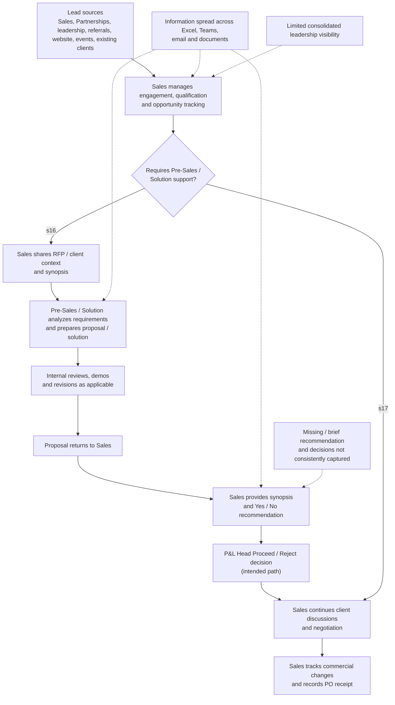
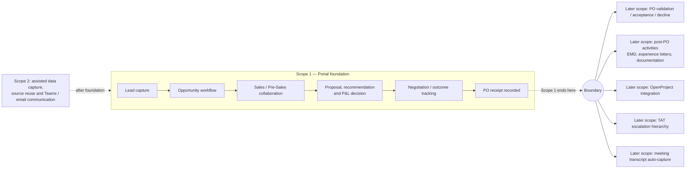
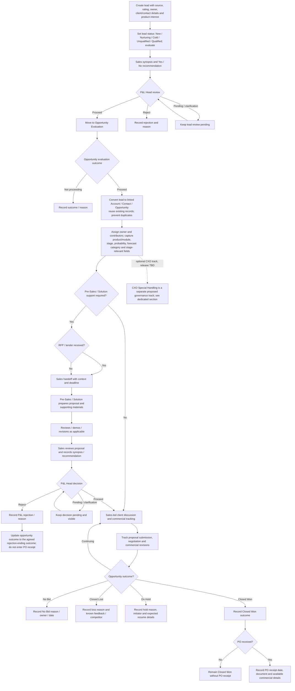
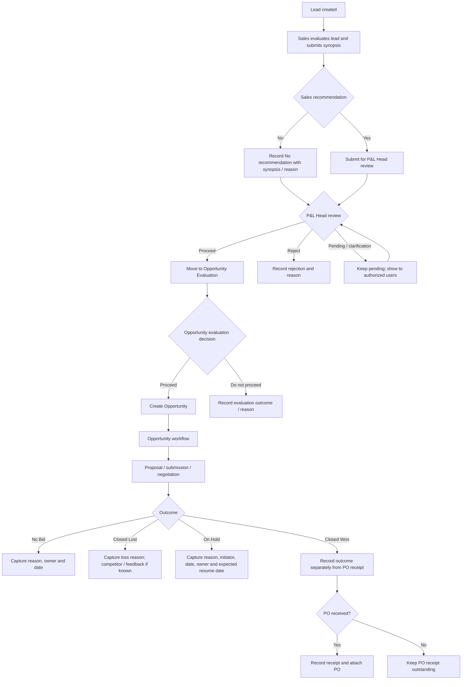
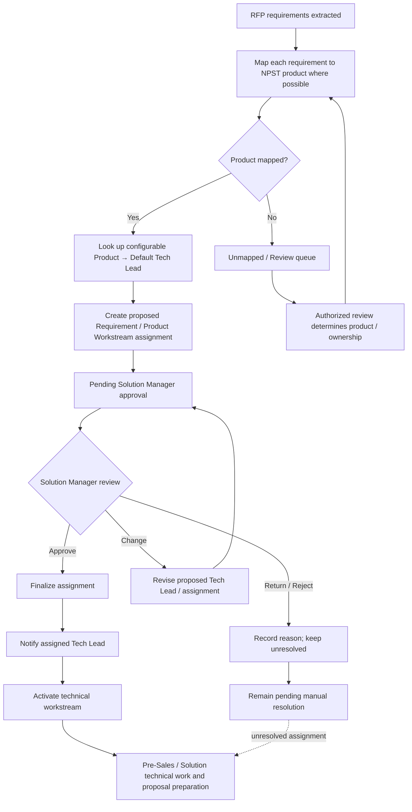
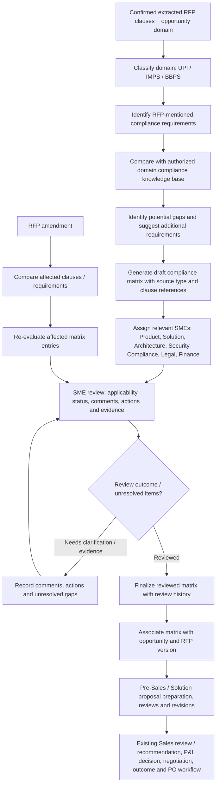
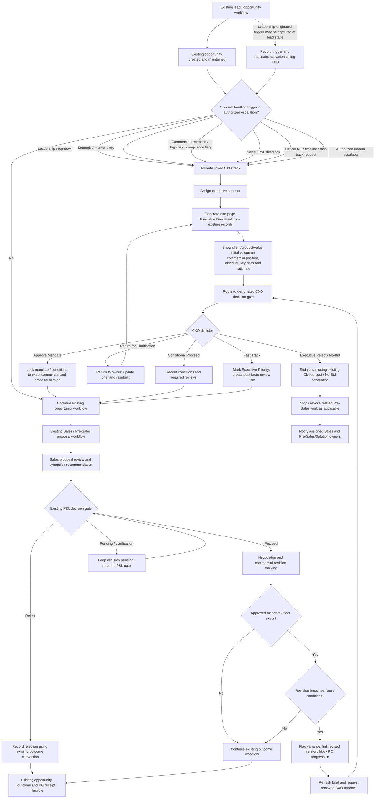
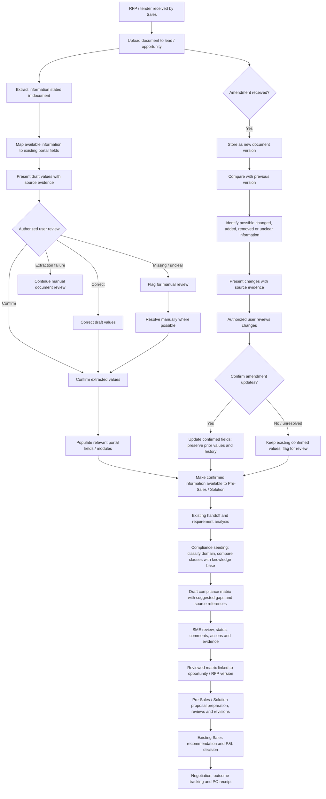
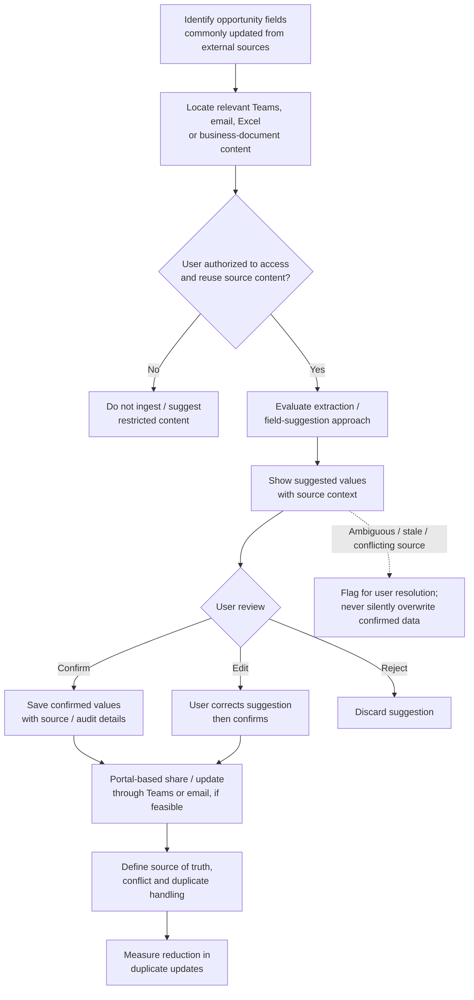

# NPST Sales Workflow & Opportunity Visibility Portal
## Product Requirements Document (PRD)

**Version:** 1.0 (Pre-Final)  
**Date:** 3 November 2026  
**Status:** Pre-final draft for stakeholder validation; unresolved decisions are explicitly retained as TBD  
**Lifecycle boundary:** Lead/opportunity through PO receipt

---

## 1. Purpose

Build an in-house portal that provides a shared, role-appropriate view of NPST sales opportunities through **PO receipt**. It must support Sales and Pre-Sales/Solution collaboration, capture proposal decisions, preserve commercial history, and provide leadership visibility without adding unnecessary administrative work.

The portal is the opportunity workflow and visibility layer. Scope 1 does not replace Teams, Outlook, Excel or OpenProject. Reducing duplicate updates across these tools is a high-priority Scope 2 objective.

## 2. Existing Workflow and Pain Points

### Existing workflow — concise view

1. Leads originate from Sales, Partnerships, leadership, referrals, website enquiries, events and existing clients.
2. Sales manages client engagement, qualification, follow-ups, commercial discussions, opportunity tracking and coordination with Pre-Sales/Solution.
3. For RFP/RFI/tender opportunities, Sales shares the RFP and synopsis/context with Pre-Sales/Solution.
4. Pre-Sales/Solution analyzes requirements, prepares the solution/proposal and supporting documents, coordinates demos and internal reviews, revises and submits the proposal.
5. The proposal returns to Sales for a synopsis and Yes/No recommendation. Responses are often missing or limited to a bare “Yes.”
6. The intended decision path is for the relevant P&L Head to review Sales’ recommendation and decide whether NPST should proceed or reject. P&L Heads are not currently part of the regular sync.
7. Sales continues client discussions and negotiations, tracks commercial changes and records PO receipt when received.

### Current pain points

- Opportunity information is split across Excel, Teams, email and documents; there is no single reliable opportunity view.
- Information shared in Teams/email may later be copied into Excel, causing duplicate updates.
- Leadership lacks consolidated visibility into stages, owners, next actions, product verticals and pending decisions.
- Sales-to-Pre-Sales/Solution handoffs and pending inputs are difficult to track.
- Sales synopsis/recommendation is often missing or insufficient; P&L decisions are not reliably captured in the workflow.
- Commercial changes are difficult to compare with NPST’s initial proposal and final position.
- Stage-irrelevant mandatory fields can create unnecessary data-entry burden.
- Sensitive RFP, proposal and commercial documents require controlled access.
- OpenProject is separate from the sales process; integration is deferred beyond Scope 1.

### Existing workflow — Mermaid flowchart

## 3. Scope and Release Boundaries

### Scope 1 — Portal foundation

**Scope 1 ends at PO receipt.** Includes:
- Lead, account, contact and opportunity records.
- Salesforce-derived Lead Management fields: lead source, rating, owner, status and supporting details, using source-defined values where confirmed.
- Lead approval/request tracking, including approver selection, approve/reject/reassign actions, pending requests and approval history; this supports but does not replace the existing Sales synopsis and P&L Head decision gates.
- Ownership, contributor assignment and collaboration.
- Sales and Pre-Sales/Solution workflow visibility.
- RFP/proposal documents, handoffs, revisions and submission status.
- Sales synopsis and Yes/No recommendation.
- P&L Head Proceed/Reject decision.
- Commercial position tracking for all opportunities.
- PO receipt recording and document attachment.
- Lead conversion from an approved/qualified lead into linked Account, Contact and Opportunity records; reuse matching records and prevent duplicate creation.
- Opportunity fields for source-defined stage, probability, forecast category and stage-gate validations, with conditional fields required only when relevant to the current stage.
- Product/module selection using source-provided options: **BBPS, UPI, ODR, CBDC, EFRM and ERP**, with dependent selections where defined by the source.
- Commercial summary field **Total Deal Size First Year = ARR + One Time**, while retaining existing commercial history.
- Role-based dashboards, search, filters and opportunity drill-down.
- **New Opportunities Report** as a portal reporting/view requirement; report-folder reference remains TBD until confirmed.
- Basic action/review notifications, subject to confirmed rules.
- Permission controls and audit history.

### Scope 2 — High-priority data capture and communication efficiency

After the portal foundation, investigate and implement feasible ways to:
- Reduce duplicate updates across portal, Excel, Teams and email.
- Reuse information already present in Teams conversations, email and business documents.
- Suggest or auto-fill plausible portal fields, with user review/confirmation.
- Let users share or update opportunity information through Teams/email from the portal, or through an appropriate connected workflow.
- Establish source-of-truth, synchronization, permissions and consent behavior.
- **RFP/tender document extraction:** extract and structure information stated in received RFP/tender PDFs and amendments; map it to relevant existing portal fields/modules; present draft values with source evidence for authorized review; and populate portal records only after confirmation.
- Version RFP/tender amendments, compare them with prior versions, identify possible changes and require review before confirmed fields are updated.
- **Compliance seeding and pre-population:** use confirmed RFP clauses and opportunity domain information to identify explicitly stated compliance requirements, compare them with an authorized domain-specific compliance knowledge base, suggest potentially applicable additional requirements, highlight possible gaps and produce a draft compliance matrix for SME review.
- **RFP technical ownership and assignment:** after RFP requirements are extracted, map requirements to NPST products where possible; use an authorized, configurable Product → Default Tech Lead mapping to propose requirement/workstream assignments; route proposals to Solution Manager review before finalization, notification and technical workstream activation. Unmapped requirements enter a review queue without automatic Tech Lead assignment.
- Support UPI, IMPS and BBPS domain mappings in the compliance knowledge base, with authorized maintenance of requirements and supporting evidence.
- Keep suggested requirements and gap flags as review prompts, not confirmed regulatory obligations or proof of NPST compliance. SMEs validate applicability, status and evidence before the matrix is treated as reviewed.

The RFP/tender extraction capability is focused on document-stated information. It does not make bid/no-bid decisions, determine NPST bid pricing, generate proposals, approve P&L decisions or perform post-PO processing. Scope 2 implementation details remain subject to feasibility, permissions and business-rule validation. Do not assume every field can be extracted or that a particular integration is feasible.
The compliance seeding capability is downstream of RFP extraction and supports Pre-Sales/Solution proposal preparation. It does not make automated bid/no-bid decisions, establish regulatory applicability, certify compliance, generate NPST proposal responses, approve P&L decisions or perform post-PO processing.

**CXO Special Handling & Strategic Deal Governance:** a proposed governance track linked to the existing opportunity for documented leadership-originated, strategic, exception, escalation or critical-timeline cases. It does not create a separate opportunity pipeline. **It is not part of the Scope 1 baseline workflow until release placement and interaction with Sales/P&L gates are approved.** Its detailed approval policy remains TBD.

### Later scope / out of Scope 1

- PO validation, acceptance or decline workflow.
- Post-PO activities (including EMD, experience letters and post-PO documentation).
- OpenProject integration, project creation or project status synchronization.
- TAT-based escalation and escalation hierarchy.
- Teams meeting transcript auto-capture and automated meeting-derived updates.
- Extraction or automation beyond the defined Scope 2 RFP/tender document extraction and assisted data-capture capabilities.
- Replacing Teams, Outlook, Excel or OpenProject.

### Release boundary — Mermaid flowchart

## 4. Users and Access Model

| User group | Primary use |
|---|---|
| Sales Representative | Own/update assigned opportunities, follow-ups, commercial position, synopsis and PO receipt |
| Sales Head | Team/territory pipeline, ownership, next actions, commercial pipeline and pending reviews |
| Pre-Sales/Solution | Requirements, RFP/proposal work, documents, reviews, revisions and handoffs |
| P&L Head | Review Sales recommendation and record Proceed/Reject for relevant product vertical/opportunities |
| Partnerships | View/contribute to partner-related opportunities according to ownership/involvement |
| Finance / Legal / Compliance reviewer | Assigned review tasks and authorized documents; submit outcome/comments/documents |
| CXO / Senior Leadership | Organization/product-level pipeline and decision visibility; read-oriented by default |
| Admin / Business Operations | Users, roles, permissions, product verticals, territories, sources and workflow configuration |

Access must be configurable by role, team, territory, product vertical, opportunity ownership, assigned task and document permissions. Do not hardcode employee names or reporting relationships.

## 5. System Workflow — Scope 1

### Scope 1 workflow overview — provisional Mermaid flowchart

**Pre-final note:** This diagram is a provisional lifecycle view. Scope 2 RFP extraction/technical ownership/compliance and CXO Special Handling are shown in their dedicated sections, not as baseline Scope 1 gates. The P&L decision placement, conversion gate and stage model remain open decisions; the diagram must not be treated as final workflow authority until those are resolved.

### Decision and exception paths — provisional Mermaid flowchart

**Pre-final note:** This alternate view reflects the lead-stage gate candidate. Its relationship to the proposal-stage synopsis/P&L gate is unresolved; use the decision register before treating either path as normative.

### Step 1 — Lead capture and Sales evaluation
**Actors:** Sales, Partnerships and authorized lead-source users.
1. Create a lead with client/contact details, source, origin, product interest and available context.
2. Assign a responsible Sales owner and relevant team/territory.
3. Record Partnership involvement where applicable, including partner owner and involvement model.
4. Sales evaluates the lead and submits a short synopsis with a **Yes / No** recommendation.
5. Route the recommendation and synopsis to the relevant P&L Head for review.
6. Keep the lead in the lead workflow until the P&L review outcome is recorded.

**Edge cases:**
- Source and partnership model may be configurable/Other.
- A lead may originate in one team and be handed to another; preserve origin and current owner.
- Reuse existing accounts/contacts rather than duplicating them.
- A No recommendation must include a synopsis/reason; the exact required fields need confirmation.
- Pending or clarification requests remain visible; TAT escalation is outside Scope 1.

### Step 2 — P&L review and Opportunity Evaluation
**Actor:** Relevant P&L Head, with Sales as the lead owner.
1. P&L Head reviews the Sales synopsis and Yes / No recommendation.
2. Record the P&L Head decision as **Proceed**, **Reject**, or **Pending / clarification**.
3. If Proceed, move the record into **Opportunity Evaluation**.
4. Complete the opportunity evaluation and record its outcome.
5. Create the Opportunity only when the evaluation decision is to proceed; retain the lead and evaluation history.

**Edge cases:**
- Rejection requires a reason and remains visible to authorized users.
- Pending / clarification does not convert the lead into an Opportunity.
- Opportunity Evaluation criteria, required fields, owner(s), and allowed outcomes remain to be confirmed.
- Avoid creating duplicate opportunities from repeated lead submissions.

### Step 3 — Opportunity creation and ownership
**Actor:** Sales owner/authorized user.
1. Create the Opportunity from an approved Opportunity Evaluation.
2. Link account and relevant contacts.
3. Capture product vertical, source/origin, owner, team/territory, opportunity type and known client context.
4. Assign relevant Sales, Partnerships and Pre-Sales/Solution contributors.
5. Display current stage, next action, next deadline and latest activity.
6. Preserve ownership and assignment history.

**Edge cases:**
- One account may have multiple opportunities.
- Partnership involvement may be partner-originated, Sales-originated, joint, partner-led, handed over or support-only; do not force one model.
- Mandatory fields must be stage-relevant; unknown/not-yet-available data must not block early work.
- Duplicate opportunity matching rules require validation.

### Salesforce-derived Lead, Conversion and Opportunity requirements

The following field names, picklist labels, stage values and approval/report behaviors are transcribed from the Salesforce screenshot-derived specification supplied for this PRD. Treat them as source requirements to validate against NPST's operating process; do not silently replace existing PRD workflow gates or infer unspecified values.

**Lead record fields**
- Salutation; First Name; Middle Name; Last Name; Suffix; Company; Lead Source; Rating; Employee Referral; Lead Owner; Lead Status; Designation; Email; Phone; Website.
- Product/module options shown in the source: **BBPS, UPI, ODR, CBDC, EFRM and ERP**. Preserve these options; dependent-picklist relationships and any additional values remain to be confirmed.
- Source lead-status values: **New, Working, Unqualified, Nurturing and Converted**. These differ from labels used elsewhere in this PRD (including Qualified and Cold/Unqualified); confirm the canonical status list, definitions and transitions before implementation. A status label alone must not bypass the existing Sales synopsis, P&L Head review or Opportunity Evaluation gates.
- Source lead-approval sequence: **Submit for Approval → Choose Next Approver → Pending Approval Request → Approve / Reject / Reassign → Approval History**. Record request status, approver/action, timestamps and history. This approval mechanism is distinct from the existing Sales recommendation, P&L decision and CXO governance gates; the policy for when lead approval is required remains TBD.

**Lead conversion**
- Conversion creates or links **Account, Contact and Opportunity** records.
- Conversion must preserve the originating lead and its history, match existing records where possible, and avoid duplicate Account, Contact or Opportunity creation.
- Conversion remains subject to the existing PRD's approval/evaluation path. The source does not define whether every lead status or approval outcome permits conversion; this remains to be confirmed.

**Opportunity stage, probability and forecast values from source**
| Source stage | Probability | Forecast category |
|---|---:|---|
| Qualification | 10% | Pipeline |
| Needs Analysis | 35% | Pipeline |
| Impact Analysis | 50% | Pipeline |
| Proposal | TBD in source | TBD in source |
| Negotiation | 90% | Commit |
| Closed Won | 100% | Closed |
| Closed Lost | TBD in source | TBD in source |

- Capture stage, probability and forecast category as related fields; apply stage-gate validations and conditional fields only when relevant to the selected stage.
- The source also references stage-gate validations and conditional fields but does not specify the exact validation rules or which fields are conditionally required. Keep these as stakeholder-validation items.
- Do not treat Closed Won as equivalent to PO receipt; preserve the PRD's lifecycle boundary and separate PO-receipt tracking.

**Commercial summary**
- Calculate/display **Total Deal Size First Year = ARR + One Time**.
- ARR/One Time field definitions, currency/period conventions, and handling of missing values are TBD. This summary does not replace the existing commercial revision history or other commercial dimensions.

**Reporting**
- Include a **New Opportunities Report** in the portal reporting/visibility layer, using source-defined fields and filters where available.
- The source references **9 report folders**, but folder names/paths and the report's exact fields, filters and audience are not specified. Do not invent them; retain as validation items.

**Source reconciliation note:** preserve the Salesforce-derived values above as source values while reconciling them with the current NPST workflow. In particular, confirm the lead-status mismatch (Working / Converted versus Qualified / Cold / Unqualified labels) and the opportunity stage model (including Impact Analysis). Do not silently replace, merge or infer stage/status transitions, probabilities or forecast categories that the source leaves unspecified.

### Step 4 — Qualification and progression
**Actor:** Sales with relevant contributors.
1. Sales updates the opportunity as qualification and client understanding progress.
2. Record next actions, follow-ups and relevant context.
3. Progress through the agreed sales stages.
4. Reflect stage and ownership in leadership views.

**Stage model to validate:** source material lists Qualification, Needs Analysis, Impact Analysis, Proposal, Negotiation, Closed Won, Closed Lost, No Bid and On Hold. Confirm final stages/statuses and allowed transitions; do not assume all are sequential stages.

**Edge cases:**
- **On Hold:** capture reason, client/NPST initiator, initiator/date, expected resume date, owner and history; exact required fields to confirm.
- **No Bid:** capture reason, owner and date.
- **Closed Lost:** capture reason, competitor where known, client feedback where available and date.
- **Closed Won:** record outcome but distinguish it from PO receipt.
- Reopening/changing an outcome requires authorized action and audit; exact rule to confirm.

### RFP/Tender document extraction — Scope 2 (separate from Scope 1 baseline workflow)
**Actor:** Sales owner / authorized user. **Trigger:** RFP/tender document received by Sales.

This capability supports the existing workflow; it does not replace lead/opportunity evaluation, Sales ownership, the handoff, or Pre-Sales/Solution proposal work. It is a Scope 2 enhancement and is not a prerequisite for proceeding manually.

**Process sequence:**
1. Sales uploads or attaches the received RFP/tender PDF to the relevant lead or opportunity.
2. The portal extracts information stated in the document and maps available values to relevant existing portal fields/modules. Candidate information includes client-stated requirements, scope, deliverables, eligibility/qualification criteria, submission instructions and deadlines, evaluation criteria, required documents, commercial/quantity details and other fields already defined in the portal. The initial field set and mapping require validation.
3. Present extracted values as **unconfirmed drafts**, with source evidence (document/version and page/section or text excerpt where available).
4. Sales or another authorized reviewer validates the draft values, corrects them, confirms them or leaves them unresolved.
5. Populate relevant portal fields/modules only with confirmed values. Preserve the document and the review/confirmation history.
6. Sales continues the existing handoff with the RFP/tender document, synopsis/context, deadline and confirmed information available to Pre-Sales/Solution.
7. Pre-Sales/Solution uses the confirmed information for requirement analysis, proposal preparation, reviews and revisions. The existing Sales recommendation, P&L decision, negotiation, outcome tracking and PO receipt workflow remains unchanged.

**Amendment handling:**
- Store each received amendment as a distinct version linked to the same RFP/tender and lead/opportunity.
- Compare the amendment with the previous version and identify possible changed, added, removed or unclear information.
- Present detected changes with source evidence from the relevant versions.
- Require authorized user review and confirmation before updating confirmed portal values.
- Preserve prior confirmed values and amendment review history; do not silently overwrite them.
- If a change cannot be reliably extracted or mapped, flag it for manual review.

**Exceptions and controls:**
- Missing, ambiguous, conflicting or unreadable information is flagged; do not infer or fabricate values.
- Extraction failure must not block manual document review or the existing handoff.
- Authorized users may correct drafts or leave fields unresolved.
- Source documents, extracted values and evidence follow existing role/document permissions.
- Record extraction status, source/version, draft values, corrections, confirmations and amendment updates in review history.
- Extraction is limited to structuring information stated in the RFP/tender. It does not automate bid/no-bid decisions, NPST bid pricing, proposal generation, P&L approval or post-PO processing.

**Open questions:** initial extraction field set and module mapping; supported formats beyond PDF; upload/trigger behavior; roles allowed to upload/review/confirm; source-evidence format and retention; amendment supersession rules; and handling of multiple RFPs/amendments linked to one opportunity.

### RFP technical ownership and assignment — Scope 2 (separate capability)
**Actors:** Sales (RFP intake/handoff), authorized mapping-master maintainers, Solution Manager, assigned Tech Leads. **Placement:** After RFP requirement extraction and product mapping, before technical workstream execution and proposal preparation.

- **Requirement-level product mapping:** map each extracted RFP requirement to an NPST product where possible. Preserve the requirement-to-product mapping and allow multiple proposed assignments for one RFP across product workstreams.
- **Configurable ownership master:** maintain a configurable **Product → Default Tech Lead** mapping. Only authorized users may maintain it; do not hard-code employee assignments.
- **Proposed assignment:** for each mapped Requirement / Product Workstream, look up the configured default and create a proposed Tech Lead assignment. Proposed assignments are not active until approved.
- **Solution Manager review:** assignments remain **Pending Approval** until reviewed. Solution Manager may Approve, Change, or Return/Reject an assignment. Changed assignments must be reviewed before finalization.
- **Notification and activation:** after approval, finalize the assignment, notify the assigned Tech Lead, and activate the corresponding technical workstream. Keep technical assignment distinct from the overall opportunity/RFP owner and Sales/Pre-Sales handoff ownership.
- **Unmapped requirements:** route requirements with no product mapping to an **Unmapped / Review** queue. Do not create an automatic Tech Lead assignment until an authorized review establishes the mapping/ownership.
- **Status and audit:** support assignment states including **Pending Approval, Approved, Rejected/Changed, and Notified**, with assignment, change, approval and notification history. Preserve proposed and finalized assignment versions.
- **Exceptions:** do not assume assignment behavior when a requirement maps to multiple products, ownership is shared, or the default Tech Lead is unavailable/inactive; route these cases for review and retain the unresolved state.
- **Downstream use:** approved assignments and requirement context are available to Pre-Sales/Solution for technical workstream execution, requirement analysis, proposal preparation, reviews and revisions. Existing Sales recommendation, P&L decision, negotiation, outcome and PO receipt steps remain unchanged.

**Open questions:** rules for multi-product mapping and shared ownership; fallback when a mapped Tech Lead is unavailable/inactive; who may maintain the product/ownership master; whether Solution Manager may delegate approval; and whether any assignment status blocks proposal progress.

### RFP technical ownership and assignment — Mermaid flowchart

### Compliance seeding and pre-population — Scope 2 (separate capability)
**Actors:** Pre-Sales/Solution coordinator and assigned SMEs. **Trigger:** RFP clauses have been extracted and confirmed/reviewed sufficiently for requirement analysis.

This capability consumes extracted RFP clauses and opportunity/domain information. It supports, but does not replace, Pre-Sales/Solution analysis and proposal preparation.

**Process sequence:**
1. Use extracted RFP clauses and opportunity domain information to classify the opportunity against supported domains (initially UPI, IMPS and BBPS, subject to confirmed taxonomy).
2. Identify compliance requirements explicitly mentioned in the RFP and retain their clause references.
3. Compare those requirements with the authorized, domain-specific compliance knowledge base.
4. Identify possible gaps and suggest additional potentially applicable requirements, with context explaining why each suggestion may be relevant.
5. Generate a draft compliance matrix containing the RFP-mentioned requirements and suggested additional items, clearly distinguishing their source type.
6. Assign relevant SMEs from Product, Solution, Architecture, Security, Compliance, Legal and Finance for review as applicable.
7. SMEs review applicability, requirement interpretation, compliance status, comments, actions and evidence; they may Approve, Reject, Comment, Upload Evidence and mark Full / Partial / Non-Compliant.
8. Preserve unresolved items and gaps; publish the final reviewed matrix only after the applicable review process is complete.
9. Associate the reviewed matrix with the opportunity and specific RFP version, and make it available to Pre-Sales/Solution for proposal preparation, internal reviews, revisions and submission.
10. If an RFP amendment changes relevant clauses, re-evaluate affected requirements and matrix entries; retain the prior matrix/review history and require SME review of changed entries.

**Compliance knowledge base:**
- Maintain domain-specific compliance categories/mappings for UPI, IMPS and BBPS.
- Support authorized creation, update, retirement and review of knowledge-base entries, including requirement description, domain mapping, applicability context and supporting references/evidence.
- Knowledge-base content and suggested requirements are advisory until validated by the responsible SMEs.

**Draft compliance matrix fields:** requirement; source type (RFP-mentioned / knowledge-base suggestion); RFP clause reference where applicable; domain; description; assigned reviewer; compliance status (Full / Partial / Non-Compliant, with unresolved/not reviewed states as needed); comments; actions; evidence references; review status.

**Evidence repository:**
- Support linking relevant certificates, audit reports, security policies, VAPT reports, DR documents and BCP documents to requirements and matrix entries.
- Apply document access permissions and versioning; retain evidence references and review history.
- Evidence availability alone must not automatically mark a requirement compliant.

**Gap-analysis example (illustrative, not a regulatory determination):**
- If an RFP mentions HSM, Data Localization and DR Site requirements, the system may surface related knowledge-base suggestions such as HSM key-management/control evidence, data-location and processing details, DR site coverage, DR/BCP documentation, recovery objectives and DR testing evidence where those items exist in the maintained knowledge base.
- Each suggestion must show its rationale/context and be labeled as a potential additional requirement. SMEs determine applicability, required response and compliance status. Do not present suggestions as confirmed obligations unless validated.

**Controls and exceptions:**
- Missing, ambiguous, conflicting or unmapped clauses are flagged for SME interpretation; do not infer definitive obligations.
- Knowledge-base suggestions must not be treated as confirmed regulatory obligations or proof of compliance.
- SMEs validate applicability, status and evidence; unresolved gaps remain visible.
- Preserve reviewer assignments, decisions, comments, status changes, evidence links and matrix versions.
- Restrict documents, knowledge-base maintenance and matrix actions according to authorized roles.
- Amendment-driven re-evaluation is limited to affected clauses/requirements where identifiable; uncertain impact is flagged for review.

**Open questions:** initial UPI/IMPS/BBPS taxonomy and knowledge-base content; knowledge-base owner and approval cadence; reviewer assignment rules and whether all listed SME functions are required for every opportunity; status transitions and what constitutes matrix completion; evidence retention/access rules; and how amendment impact is determined when clause mapping is uncertain.

### Compliance seeding workflow — Mermaid flowchart

### Step 5 — Sales-to-Pre-Sales/Solution handoff
**Actors:** Sales owner and Pre-Sales/Solution assignee.
1. Sales creates a handoff/request for an RFP/RFI/tender or other opportunity requiring solution support.
2. Attach/link RFP and client documents; provide synopsis/context available.
3. Identify requested support and relevant deadline.
4. Assign Pre-Sales/Solution; show opportunity context and authorized documents.
5. Display owner, assignee, status, due date and pending inputs.

**Edge cases:**
- Sales provides the RFP synopsis; Pre-Sales/Solution begins processing after handoff.
- Non-RFP opportunities are supported; RFP-specific tasks are conditional.
- Finance/Legal/Compliance reviewers are assigned only when required, to named reviewers, with task-focused access.
- Missing information is shown as a pending input, not silently treated as complete.
- Exact handoff statuses and mandatory fields require validation.

### Step 6 — Pre-Sales/Solution proposal preparation
**Actor:** Pre-Sales/Solution.
1. Analyze requirements/RFP/RFI/tender, using confirmed extracted information where available.
2. For RFP/tender responses, use the Scope 2 compliance seeding capability to prepare a draft compliance matrix from RFP clauses and the domain knowledge base.
3. Assign relevant SMEs from Product, Solution, Architecture, Security, Compliance, Legal and Finance to review applicable matrix entries.
4. Validate suggested requirements, applicability, compliance status and evidence; retain unresolved gaps and actions.
5. Associate the reviewed matrix with the opportunity and RFP version and use it as an input to proposal preparation.
6. Prepare solution, response, proposal, demo and supporting documents as applicable.
7. Record review outcomes, comments, requested changes and supporting documents.
8. Maintain proposal versions/revisions and submission status.
9. When ready, hand the proposal to Sales for synopsis/recommendation.

**Edge cases:**
- Reviewers may approve, reject, request changes, comment or upload supporting documents.
- Review assignment does not grant general opportunity ownership or broad pipeline access.
- Preserve earlier proposal versions and review history.
- RFP, demo and Finance/Legal review steps are conditional.
- PO receipt does not mean Pre-Sales/Solution work is complete; post-PO work is outside Scope 1.
- Compliance matrix suggestions are advisory; SMEs validate applicability and compliance status. Evidence links do not automatically establish compliance.
- Unresolved compliance gaps remain visible for proposal decision-making; the PRD does not define automatic blocking rules.
- Amendment-driven changes require re-review of affected matrix entries and preservation of prior review history.

### Step 7 — Sales synopsis and recommendation (Scope 1 decision gate)
**Actor:** Sales owner. **Trigger:** proposal marked ready for Sales review.
1. Notify/assign Sales review.
2. Sales records **Yes / No** recommendation.
3. Sales provides a short synopsis explaining the proposal/opportunity context.
4. A **No** recommendation requires a reason.
5. Allow improvement points, concerns or conditions where applicable.
6. Submit recommendation to the relevant P&L Head.
7. Preserve author, timestamp, content and revisions.

**Edge cases:**
- Bare Yes/No without synopsis is not a complete submission.
- Missing Sales response remains visibly pending; TAT escalation is out of Scope 1.
- Return/request-for-information behavior requires workflow confirmation.
- Required content for Yes and turnaround rules remain TBD.

### Step 8 — P&L Head decision (Scope 1 decision gate)
**Actor:** relevant P&L Head. **Trigger:** Sales submits recommendation.
1. Route by product vertical/ownership configuration.
2. Show proposal documents, Sales synopsis and recommendation within permitted access.
3. P&L Head records **Proceed** or **Reject**, with reason/comment.
4. Make decision visible to authorized Sales and Pre-Sales/Solution users.
5. Record decision owner, timestamp and history.

**Edge cases:**
- P&L Heads are not currently part of the regular sync; portal review must not assume meeting participation.
- Pending decisions remain visible.
- Rejection status mapping and resubmission behavior require confirmation.
- Backup approver and return-for-clarification behavior are TBD.
- This is an internal proceed/reject decision, not PO acceptance/validation.

### CXO Special Handling & Strategic Deal Governance — special track
**Placement:** A governance track linked to the existing Opportunity. It does not create a separate pipeline or replace the standard Sales recommendation, P&L decision, opportunity outcome or PO receipt workflow.

**Trigger scenarios:**
- CXO/leadership-originated opportunity or top-down lead origination.
- Strategic or market-entry deal.
- Commercial exception or high-risk/compliance flag.
- Sales/P&L deadlock or escalation.
- Critical RFP timeline / fast-track request.
- Authorized manual escalation with mandatory rationale.

**Track workflow:**
1. An authorized user activates CXO Special Handling on the existing opportunity, records the trigger/rationale and assigns an executive sponsor. For leadership-originated leads, the trigger may be captured at lead stage; track activation remains linked to the opportunity record once created. Exact activation timing/authority is TBD.
2. Generate a concise **one-page Executive Deal Brief** from existing records, avoiding duplicate data entry. Include client, product, opportunity value, initial vs. current commercial position, discount where available, major Pre-Sales/Solution, Legal, Finance and risk/compliance issues, and escalation rationale. The brief must support the primary decision without requiring document downloads; source documents remain available through permissioned links.
3. Route the brief to the designated CXO decision gate. Record decision, approver, timestamp, rationale, conditions and the exact linked commercial/proposal version.
4. Support **Approve Mandate**, **Conditional Proceed**, **Return for Clarification**, **Fast-Track**, and **Executive Reject/No-Bid**. Return for Clarification routes back to the owner for an updated brief and resubmission.
5. Bind approved mandate/floor/conditions to the exact approved commercial revision and proposal version. Preserve the approved values/terms and version history.
6. On approval/conditional proceed/fast-track, mark associated Pre-Sales tasks **Executive Priority** and surface them in the relevant Pre-Sales/Solution queue. Route ahead of routine work according to an approved priority policy; numeric SLA and ordering policy are TBD. Conditional Proceed fulfillment and any additional Legal/Compliance review are tracked as conditions.
7. Continue through the existing proposal, negotiation, outcome and PO receipt lifecycle. CXO approval does not replace the existing Sales recommendation or P&L decision unless a separately approved policy explicitly defines an interaction; that interaction is TBD.
8. If a later commercial revision breaches the approved floor or conditions, flag the variance, link it to the revised version and require renewed executive approval. The revised position must not be treated as approved, and progression to PO is blocked until required approval is obtained. Preserve the prior mandate and decision.
9. **Executive Reject/No-Bid** ends the pursuit using existing Closed Lost / No-Bid conventions; do not create a new opportunity status. Stop or revoke associated Pre-Sales work as applicable and notify assigned Sales and Pre-Sales/Solution owners. Exact status mapping and cancellation behavior are TBD.

**Governance and controls:**
- General CXO pipeline access is read-only by default. Action controls are enabled only for users assigned to the relevant Special Handling case or otherwise authorized.
- Support restricted/confidential opportunity visibility where authorized; apply permissions to the brief, linked documents, commercial versions and decision actions.
- Preserve immutable decision, condition, override, version-linkage and audit history.
- Dashboard/queue pointers include pending CXO decisions, Executive Priority Pre-Sales work, commercial re-approval/mandate variance, and required Fast-Track post-facto reviews.
- Fast-Track requires a visible post-facto review item; owner, deadline and completion criteria are TBD.
- CXO decisions remain distinct from Sales recommendation, P&L decision, opportunity outcome and PO receipt.

**Open questions:** activation authority/timing for leadership-originated leads; mandatory vs. discretionary triggers; CXO routing/delegation and sponsor assignment; configurable threshold rules (margin, discount, TCV and other measures); mandate/floor definition and breach calculation; which CXO outcomes unblock proposal generation; which conditions require Legal/Compliance approval; conditional-proceed closure authority; priority policy and SLA; actions paused during re-approval; Fast-Track post-facto review owner/deadline; confidential access rules; and mapping of Executive Reject to existing Closed Lost / No-Bid conventions.

### CXO Special Handling — Mermaid workflow

### Step 9 — Proposal submission, negotiation and commercial revisions
**Actors:** Sales, with Pre-Sales/Solution support as needed.
1. Track proposal submission and relevant client response.
2. Sales records meaningful commercial changes during discussions.
3. Preserve initial proposed position, subsequent revisions and final proposed position before PO receipt.
4. Show current values and revision history to authorized users.
5. Support comparison/analytics across all opportunities.

**Commercial dimensions:** quantity, unit price, total value, plus an option to add other/custom dimensions. Support opportunities where standard dimensions do not apply.

**Low-overhead requirement:**
- Do not require Sales to log every conversation or maintain a separate audit trail.
- Capture mechanism (manual, document-assisted, integration or combination) is TBD and must be validated against Sales’ actual process.
- Revisions must not overwrite the only record of the initial proposal.

**Edge cases:** non-RFP opportunities are included; multiple revisions must be retained; PO values may differ from final proposal; custom dimensions should not require a schema change for each opportunity.

### Step 10 — Opportunity outcome and PO receipt
**Actor:** Sales owner/authorized user.
1. Record outcome using the confirmed stage model.
2. When a PO is received, record PO receipt date/status and attach/link the PO.
3. Capture PO-received commercial details for comparison where applicable.
4. Distinguish **PO Received** from **Closed Won**.
5. Preserve pre-PO opportunity and commercial history.

**Boundary and edge cases:**
- Scope 1 records PO receipt only; no validation, acceptance or decline.
- Closed Won without a PO remains distinct from PO Received.
- PO values may differ; show variance where data exists.
- Multiple POs per opportunity may be possible; support decision requires confirmation.
- Missing PO details must not be fabricated or treated as validated.

### Step 11 — Dashboards and visibility
1. Organization/product views show active opportunities, stage distribution, owners, next actions, deadlines and pending decisions.
2. Product vertical pages show opportunity lists and relevant pending work.
3. Opportunity detail provides drill-down into workflow, documents, recommendations, decisions, commercial history and PO receipt.
4. Leadership is read-oriented by default; updates remain with authorized owners.
5. Search/filter by product vertical, stage, owner/team, territory/business coverage, client, source, decision status and deadline/attention status.
6. Show pending CXO decisions, active CXO Special Handling opportunities, Executive Priority Pre-Sales queue items, commercial mandate variances/re-approval, and required Fast-Track post-facto reviews due/pending.
7. Keep general CXO pipeline views read-only by default; expose decision/action controls only for authorized assigned cases. Respect restricted/confidential visibility.

**Edge cases:** enforce record/document permissions; distinguish missing data from zero; definitions of stalled/overdue require confirmation; TAT escalation is deferred.

## 6. Scope 2 Workflow — Data Capture and Communication Efficiency

### RFP/Tender extraction and amendment workflow — Mermaid flowchart

### Scope 2 workflow — Mermaid flowchart

1. Identify portal fields commonly updated from Teams, email, Excel and proposal documents.
2. Identify source messages/documents and authorized users.
3. Evaluate ways to suggest or auto-fill field values from those sources.
4. Present suggestions for user review/confirmation before saving.
5. Evaluate portal-based sharing or updating through Teams/email.
6. Define source-of-truth, conflict handling, duplicate prevention, audit, consent and permission behavior.
7. Measure whether duplicate updates are reduced.
8. For RFP/tender PDFs and amendments, extract document-stated information, map it to existing portal fields, present draft values with source evidence, and populate fields only after authorized review and confirmation.
9. Version amendments, compare them with prior documents, identify possible changes and require review before confirmed values are updated.
10. Make confirmed RFP/tender information available to Pre-Sales/Solution for requirement analysis, proposal preparation, reviews and revisions; continue the existing Sales recommendation, P&L decision, negotiation, outcome and PO receipt workflow.
11. Within Pre-Sales/Solution preparation, classify the opportunity domain (UPI, IMPS or BBPS), identify RFP-mentioned compliance requirements, compare them with the authorized compliance knowledge base, identify potential gaps and generate a draft compliance matrix.
12. Assign relevant SMEs to review applicability, status, comments, actions and evidence; preserve unresolved gaps and publish the reviewed matrix linked to the opportunity and RFP version.
13. Re-evaluate affected matrix entries when an amendment changes relevant clauses; require SME review before the updated matrix is treated as reviewed.

**Scope 2 edge cases:** conflicting values, stale/forwarded threads, ambiguous opportunity references, incomplete extraction, user correction/rejection, revoked access, and content the user is not authorized to store. For RFP/tender extraction, missing, ambiguous, conflicting or unreadable information must be flagged rather than guessed; extraction failure must allow manual processing to continue; amendment changes require review; and source evidence and review history must be retained according to confirmed permissions/retention rules. Automated updates must not silently overwrite confirmed business data.
For compliance seeding, knowledge-base suggestions remain advisory; SMEs validate applicability and compliance status. Unresolved gaps remain visible, evidence is versioned/access-controlled, and amendment-driven changes require review.

## 7. User Stories and Acceptance Criteria

### US-1 — Sales maintains an opportunity
**As a Sales user,** I want one opportunity record with owner, stage, next action and context so stakeholders can see current status without spreadsheet consolidation.
- Create from qualified lead or authorized direct path.
- Owner, stage and next action are visible.
- Only stage-relevant fields are required.
- Updates/ownership changes are auditable.

### US-16 — Sales manages leads and converts approved leads without duplication
**As a Sales user,** I want source-defined lead fields and statuses and a controlled conversion path so lead context is retained when an opportunity is created.
- Capture the source-listed lead fields: Salutation, First/Middle/Last Name, Suffix, Company, Lead Source, Rating, Employee Referral, Lead Owner, Lead Status, Designation, Email, Phone and Website.
- Support the source-listed status values New, Working, Unqualified, Nurturing and Converted alongside the PRD's existing candidate labels until the canonical list/transitions are validated; do not silently merge labels.
- Support source-listed product/module options BBPS, UPI, ODR, CBDC, EFRM and ERP.
- Preserve the existing Sales synopsis, P&L Head review and Opportunity Evaluation gates before conversion.
- Create or link Account, Contact and Opportunity records; reuse matching records and prevent duplicates.
- Retain the originating lead and conversion history.

### US-17 — Sales manages opportunity stages, forecast fields and product selection
**As a Sales user,** I want stage-relevant opportunity fields and product/module selections so pipeline information is consistent without requiring irrelevant fields.
- Capture source stage/probability/forecast mappings: Qualification (10%, Pipeline), Needs Analysis (35%, Pipeline), Impact Analysis (50%, Pipeline), Proposal (TBD), Negotiation (90%, Commit), Closed Won (100%, Closed), Closed Lost (TBD).
- Apply stage-gate validations and conditional fields according to the selected stage once rules are confirmed; do not invent missing values.
- Support BBPS, UPI, ODR, CBDC, EFRM and ERP, including source-defined dependent selections.
- Calculate/display Total Deal Size First Year = ARR + One Time while preserving commercial history.
- Keep unresolved stage/value mappings as TBD until reconciled.

### US-18 — Authorized users track approval requests
**As an authorized user,** I want approval requests assigned and tracked so pending, approved, rejected or reassigned requests are visible with history.
- Select an approver and record approve, reject or reassign actions.
- Show pending requests and approval history.
- Keep this capability distinct from existing Sales recommendation, P&L decision and CXO governance gates.

### US-19 — Leadership accesses the New Opportunities Report
**As a leadership or authorized reporting user,** I want a New Opportunities Report so I can review newly created opportunities using source-defined report fields and filters.
- Provide the report within the portal’s reporting/visibility layer.
- Reflect that the source references 9 report folders; folder names/paths, exact report fields and filters remain TBD.
- Apply existing role and record permissions.

### US-2 — Pre-Sales/Solution receives a clear handoff
**As a Pre-Sales/Solution user,** I want RFP/client context, requested work, owner and deadline in one assigned item.
- Handoff includes available synopsis and documents.
- Assignment, status and due date are visible.
- Missing inputs are identifiable.
- Finance/Legal reviews can be assigned with task-focused access.

### US-3 — Sales submits a complete recommendation
**As a Sales user,** I want to provide Yes/No with synopsis and required reason so the P&L Head can decide.
- Yes/No and synopsis are recorded.
- No requires a reason.
- Improvement points/concerns can be captured.
- Submission routes to the relevant P&L Head and is timestamped.

### US-4 — P&L Head decides whether to proceed
**As a P&L Head,** I want to review the proposal and Sales recommendation and record Proceed/Reject.
- Relevant proposal and synopsis are accessible.
- Proceed/Reject and comments/reason can be recorded.
- Decision owner/timestamp are preserved.
- Decision status is visible to authorized stakeholders.

### US-5 — Sales tracks commercial changes with low overhead
**As a Sales user,** I want initial, revised/final and PO-received positions to be comparable without maintaining a separate audit log.
- Applies to all opportunities.
- Quantity, unit price, total value and custom dimensions are supported.
- Initial position is preserved; revisions do not erase prior values.
- Final pre-PO and PO-received positions can be compared.
- Capture mechanism is validated with Sales before implementation.

### US-6 — Sales records PO receipt
**As an authorized user,** I want to record PO receipt and attach the PO.
- PO receipt is distinct from Closed Won.
- PO document can be attached/linked.
- PO validation/acceptance is not required in Scope 1.

### US-7 — Leadership sees pipeline and pending decisions
**As a leader,** I want product/organization pipeline views with drill-down.
- Views respect role/product/territory access.
- Pending Sales recommendations and P&L decisions are visible.
- Opportunity detail shows relevant workflow/commercial history.
- Leadership is read-only by default.

### US-8 — Users avoid duplicate updates (Scope 2)
**As a Sales user,** I want to reuse information already shared in Teams/email/documents.
- Candidate sources/fields are identified.
- Suggested values are reviewed before saving.
- Portal-to-Teams/email sharing/update paths are evaluated.
- Conflicts/corrections do not silently overwrite data.
- Permissions, consent and feasibility are validated.

### US-9 — Sales extracts and confirms RFP/tender information (Scope 2)
**As a Sales user,** I want information stated in received RFP/tender documents structured into relevant portal fields so that I can review it and provide Pre-Sales/Solution with reliable requirement context.
- Upload/attach an RFP/tender PDF to the relevant lead/opportunity.
- Extract available document-stated information and map it to defined portal fields/modules.
- Display draft values with source evidence.
- Allow authorized users to correct, confirm or leave values unresolved.
- Populate portal records only after confirmation.
- Preserve extraction, correction and confirmation history.
- Allow manual processing and handoff to continue if extraction fails.

### US-10 — Sales reviews RFP/tender amendments (Scope 2)
**As an authorized user,** I want amendments versioned and compared with prior documents so that changes can be reviewed before confirmed portal information is updated.
- Store each amendment as a distinct version linked to the same RFP/tender and lead/opportunity.
- Identify possible changed, added, removed or unclear information.
- Display changes with source evidence.
- Require user review/confirmation before updating confirmed portal values.
- Preserve prior values and amendment review history.
- Do not silently overwrite confirmed information.

### US-15 — RFP requirements receive reviewed technical ownership
**As a Pre-Sales/Solution user,** I want extracted RFP requirements mapped to NPST products and proposed Tech Leads so that technical workstreams have clear ownership before execution.
- Map extracted requirements to products where possible and support multiple product workstreams for one RFP.
- Use an authorized configurable Product → Default Tech Lead master; do not hard-code assignments.
- Keep proposed assignments pending until Solution Manager review; support approve, change and return/reject.
- Finalize and notify the assigned Tech Lead only after approval, then activate the workstream.
- Route unmapped requirements to a review queue without automatic assignment.
- Preserve assignment status, changes, approval and notification history.
- Keep assignment ownership distinct from opportunity/RFP ownership.

### US-11 — Pre-Sales/Solution prepares a reviewed compliance matrix
**As a Pre-Sales/Solution user,** I want RFP-mentioned compliance requirements and potentially applicable domain requirements organized into a matrix so SMEs can review them before proposal finalization.
- Consume extracted RFP clauses and opportunity domain information.
- Support UPI, IMPS and BBPS domain mapping through an authorized knowledge base.
- Distinguish RFP-mentioned requirements from knowledge-base suggestions and retain clause references/source context.
- Identify potential gaps and provide rationale/context for suggestions.
- Generate a draft matrix with requirement, source type, clause reference, domain, description, reviewer, compliance status, comments, actions, evidence references and review status.
- Keep suggestions advisory; SMEs validate applicability, status and evidence.
- Associate the reviewed matrix with the opportunity and RFP version for proposal preparation.

### US-12 — SMEs review compliance requirements and evidence
**As an assigned SME,** I want to review matrix entries, record a status and attach evidence so the proposal team can use a reviewed compliance view.
- Relevant Product, Solution, Architecture, Security, Compliance, Legal and Finance reviewers can be assigned as applicable.
- Review actions include Approve, Reject, Comment, Upload Evidence and mark Full / Partial / Non-Compliant.
- Evidence can link to certificates, audit reports, security policies, VAPT reports, DR documents and BCP documents.
- Evidence access and versions are controlled; evidence does not automatically establish compliance.
- Preserve reviewer actions, comments, evidence references, unresolved gaps and matrix history.

### US-13 — Compliance matrix responds to RFP amendments
**As a Pre-Sales/Solution user,** I want affected compliance entries re-evaluated when an RFP amendment changes requirements.
- Link the matrix to the relevant RFP version.
- Identify affected clauses/entries where possible and flag uncertain impact.
- Require SME review of changed entries before treating the matrix as reviewed.
- Preserve prior matrix versions and review history.

### US-14 — CXO Special Handling governs exceptional opportunities
**As an authorized opportunity owner or executive sponsor,** I want exceptional or strategic deals routed through a linked CXO governance track so mandate, conditions and executive decisions are visible without creating a separate pipeline.

- Capture documented trigger and rationale, assign executive sponsor and generate a one-page brief from existing records.
- Record CXO decision, approver, timestamp, rationale, conditions and linked commercial/proposal version.
- Lock approved mandate/terms to the relevant version; flag breaches and require renewed approval before PO progression.
- Mark related Pre-Sales tasks Executive Priority and surface post-facto review items for Fast-Track.
- Executive Reject/No-Bid ends the pursuit using existing outcome conventions, stops/revokes associated work as applicable and notifies assigned owners.
- Preserve restricted access, immutable decision/override history and dashboard visibility.
- Keep CXO governance distinct from Sales recommendation, P&L decision, opportunity outcome and PO receipt.

## 8. Minimum Views

### Lead list
Lead/client name; source; rating; status; owner; product interest; next action/deadline; pending approval/review status.

### Opportunity list
Client/organization; opportunity name; product vertical/module; current stage/status; probability; forecast category; Sales owner; next action; next deadline; pending decision/attention status; Total Deal Size First Year (ARR + One Time).

### Opportunity detail
Summary/client context; owner/contributors; stage/activity history; Sales-to-Pre-Sales/Solution handoff; RFP/proposal documents and versions; extraction/review status; draft extracted values with source evidence; confirmed RFP/tender information; amendment comparison and confirmation history; Finance/Legal review status; Sales synopsis/recommendation; P&L decision; initial/revised/final commercial position; PO receipt/document; audit history.
CXO Special Handling status/trigger/rationale, executive sponsor, one-page Executive Deal Brief/version, CXO decision/approver/timestamp/conditions, linked proposal/commercial version, approved mandate/floor, variance/re-approval status, Executive Priority tasks, Fast-Track post-facto review status, and restricted-access indicator where applicable.
RFP requirement-to-product mappings; proposed/final Tech Lead assignments by requirement/workstream; Solution Manager approval status; unmapped/review queue; assignment and notification history.

### Compliance matrix view (RFP/tender opportunities)
- Matrix linked to opportunity and RFP version; requirement, source type, clause reference, domain and description.
- Assigned SME/reviewer, compliance status, comments, actions, evidence references and review status.
- RFP-mentioned requirements distinguished from knowledge-base suggestions.
- Potential gaps, unresolved applicability questions and amendment-affected entries visible.
- Evidence repository links for certificates, audit reports, security policies, VAPT reports, DR and BCP documents, subject to access permissions.

### Leadership overview
Active opportunities; stage distribution; product vertical comparison; pending Sales recommendations; pending P&L decisions; upcoming deadlines; outcomes; commercial summaries where data exists.

### Reports
- New Opportunities Report, using source-defined fields/filters where available.
- Report-folder reference: TBD until the source folder name/path is confirmed.

## 9. Notifications

Scope 1 notifications should cover assigned work/review requests, proposal ready for Sales synopsis, Sales recommendation awaiting P&L decision, decision recorded and relevant assigned-action updates. Channels, reminder frequency and exact rules are TBD. TAT escalation/hierarchy is later scope.
For CXO Special Handling, include decision requests, return-for-clarification, decision recorded, mandate variance requiring renewed approval, Executive Priority Pre-Sales handoff, Executive Reject/No-Bid work-stop notice to assigned owners, and Fast-Track post-facto review items. Exact channels, recipients and timing remain TBD.
For RFP technical ownership, notify the assigned Tech Lead after Solution Manager approval/finalization; notify relevant reviewers of pending, changed or returned assignments and unmapped requirements. Exact channels and notification timing remain TBD.

## 10. Audit and Data Integrity

Maintain history for lead creation/status/ownership changes, conversion/linking, approval requests and actions, opportunity creation/stage/status and ownership changes, handoffs, proposal versions/reviews, Sales recommendations, P&L decisions, commercial revisions and PO receipt. Preserve prior commercial values and decisions. Enforce document/commercial access server-side.

For RFP/tender extraction, also retain document uploads and versions, extraction runs/status, source evidence, draft values and field mappings, user corrections/confirmations, unresolved fields, amendment comparisons and confirmed updates. Preserve previous confirmed values; extraction or amendment processing must not silently overwrite them. Apply existing role and document permissions to source documents, extracted values and evidence.
For compliance seeding, retain knowledge-base entry/version references, domain mapping, generated matrix versions, source type and RFP clause references, suggested gap rationale, reviewer assignments/actions, compliance status changes, comments, evidence links/versions, unresolved gaps and amendment-driven re-evaluations. Preserve prior reviewed matrices and apply role-based access to knowledge-base maintenance, matrix actions and evidence documents.
For CXO Special Handling, retain activation trigger/rationale and actor, executive sponsor, Executive Deal Brief versions/source links, CXO routing and decisions, approver/timestamp/rationale/conditions, approved mandate/floor and exact proposal/commercial version, priority designation, Fast-Track/post-facto review status, variance flags, work-stop actions and renewed approvals. Decision and override history must be immutable; enforce restricted/confidential access and preserve prior approved terms.
For RFP technical ownership, retain requirement-to-product mappings, ownership-master versions/maintainers, proposed and finalized assignments, assignment status changes, Solution Manager decisions/comments, changed assignments, notification events and workstream activation history. Preserve assignment history and enforce role-based access.

## 11. Success Measures

Set targets after baseline measurement:
- Active opportunities represented in portal.
- Opportunities with owner, stage and next action.
- Proposal handoffs with completed Sales synopsis/recommendation.
- Time from Sales recommendation to P&L decision.
- Opportunities with initial and final commercial positions recorded.
- Reduction in duplicate updates after Scope 2.
- Leadership visibility without manual consolidation.

## 12. Open Questions and Pre-Final Decision Register

The following register consolidates overlapping questions from the earlier draft. These items remain unresolved; no policy or workflow behavior is inferred. Resolve them with the named business owners before approval.

### A. Lead, conversion and opportunity lifecycle
1. Confirm canonical Lead Status values and transitions, reconciling Salesforce values (New, Working, Unqualified, Nurturing, Converted) with existing NPST labels (Qualified and Cold / Unqualified).
2. Define the relationship among lead qualification, Sales synopsis/recommendation, P&L review, Opportunity Evaluation and conversion; identify the authoritative conversion trigger and whether any authorized direct path exists.
3. Decide whether Sales synopsis/P&L review is a single proposal-stage gate or multiple explicitly distinct gates; specify which opportunity/proposal types require it, required synopsis content, routing, alternate approvers and whether P&L may return for clarification.
4. Confirm the canonical opportunity stage/status/outcome model and allowed transitions, including Salesforce mappings (Qualification 10%/Pipeline; Needs Analysis 35%/Pipeline; Impact Analysis 50%/Pipeline; Proposal TBD; Negotiation 90%/Commit; Closed Won 100%/Closed; Closed Lost TBD), NPST candidate stages, and treatment of No Bid and On Hold.
5. Define stage-gate validations and conditional required fields; clarify whether stage, status and outcome are separate data concepts and how PO Received is represented separately from Closed Won.
6. Define the On Hold resume path, owner, expected resume date behavior and transition back to active pursuit.
7. Confirm Lead field/picklist values and configurability, including Lead Source, Rating, Employee Referral, approver selection and product-dependent selections.
8. Confirm the opportunity evaluation criteria and whether the decision is mandatory for every conversion path.

### B. Sales, proposal, commercial and PO handling
9. Define Sales-to-Pre-Sales/Solution handoff fields, statuses, ownership, missing-input handling and whether extraction is before, during or after handoff; clarify if RFPs can be processed at lead stage.
10. Confirm commercial capture mechanism and how non-standard dimensions are represented when quantity/unit price do not apply.
11. Define ARR and One Time, currency/period conventions, missing-value behavior and reconciliation with standard total value for Total Deal Size First Year.
12. Confirm whether multiple POs per opportunity are supported and define PO receipt fields, document links and receipt-record structure; PO validation/acceptance remains out of Scope 1.
13. Define stalled/attention status, notification channels/recipients/reminder rules and document permissions for RFP, proposal and commercial records.
14. Confirm the purpose and design of approval-request tracking: shared configurable capability or separate approval workflows; define approver selection, reassignment permissions and relationship to the Sales/P&L/CXO gates.

### C. Scope 2 RFP extraction, technical ownership and compliance
15. Confirm extraction field set/mapping, supported formats and limits, upload/review roles, source-evidence format/retention, trigger behavior and handling of multiple RFPs/amendments.
16. Define amendment identification/supersession and review rules; confirm how affected technical ownership assignments are re-evaluated when requirements change.
17. Confirm product mapping rules when one requirement maps to multiple products, shared Tech Lead behavior, fallback when a default Tech Lead is unavailable, authorized mapping-master maintainers/change approval, and Solution Manager delegation.
18. Decide whether unmapped requirements or pending technical assignments affect proposal progress; no blocking rule is assumed.
19. Confirm UPI/IMPS/BBPS compliance taxonomy, knowledge-base content/owner/maintainers/review cadence, SME assignment rules, matrix completion/status transitions and conflicting SME decision handling.
20. Confirm evidence repository permissions, retention, versioning and accepted evidence types; define amendment impact handling when clause mapping is uncertain.
21. Decide whether unresolved compliance gaps block proposal finalization/submission or remain advisory; no blocking rule is assumed.
22. Confirm Scope 2 Teams/email permissions, consent, feasibility, source-of-truth and synchronization rules.

### D. CXO Special Handling and strategic deal governance (release placement TBD)
23. Decide whether CXO Special Handling is Scope 1 or a later release; define activation timing/authority, including leadership-originated leads before opportunity creation.
24. Define mandatory/discretionary triggers, thresholds (e.g., margin, discount, TCV), threshold owner/change history, routing, designated approver, backup/delegation and executive sponsor assignment.
25. Define the CXO gate’s position relative to proposal creation and P&L review, decision precedence, which outcomes permit progression, and any required Legal/Compliance review.
26. Define Executive Deal Brief fields, source freshness, access classification and behavior for restricted records.
27. Define mandate/floor source, commercial breach calculation, affected actions paused during re-approval, approval invalidation and whether PO progression is blocked.
28. Define Conditional Proceed fulfillment evidence/closure authority; Executive Reject/No-Bid mapping, work-stop/revocation behavior and notification.
29. Define Fast-Track priority/queue behavior and post-facto review owner, deadline, evidence and completion criteria.
30. Define confidential/restricted record access and dashboard visibility, including CXO assigned-case action permissions versus read-only general pipeline access.
31. Define the audited meaning of “override,” including actor, trigger, authority and relationship to the immutable decision history.

### E. Reporting and organizational configuration
32. Confirm New Opportunities Report fields, filters, audience and the names/paths of the nine source report folders.
33. Complete the access matrix for Solution Manager, Tech Lead, executive sponsor, mapping-master maintainers and Product/Solution/Architecture/Security/Compliance/Legal/Finance SMEs; define default permissions and assignment rules.
34. Confirm the metric definition for time from Sales recommendation to P&L decision once the decision-gate model is finalized.

## 13. Explicit Decisions Captured

| Area | Current decision / confirmed boundary |
|---|---|
| Scope 1 lifecycle | Ends at PO receipt; PO validation/acceptance/decline and post-PO work are out of Scope 1. |
| Sales/P&L workflow | Sales synopsis and recommendation plus P&L Head decision are required capabilities; exact gate placement and whether there is one or more gates remain open. |
| Commercial tracking | Applies to all opportunities; preserve initial, revised and final pre-PO positions. Support quantity, unit price, total value and custom dimensions. |
| Sales effort | Minimize duplicate entry; capture mechanism remains TBD. |
| Teams/email/Excel | Duplicate-update reduction and assisted capture are Scope 2; suggested values require user review before saving. |
| OpenProject, TAT escalation, post-PO activities, Teams transcript auto-capture | Later scope / out of Scope 1. |
| RFP/tender extraction | Scope 2; draft values require authorized review/confirmation, source evidence, amendment versioning and no silent overwrites. Manual processing continues on failure. |
| RFP extraction exclusions | No automated bid/no-bid decision, NPST bid pricing, proposal generation, P&L approval automation or post-PO processing. |
| Compliance seeding | Scope 2; advisory only. SMEs validate applicability, status and evidence. Matrix is linked to opportunity and RFP version; no automated regulatory determination/certification. |
| Compliance domains | UPI, IMPS and BBPS are supported domains; taxonomy and knowledge-base content remain TBD. |
| RFP technical ownership | Scope 2; requirement-to-product mapping and proposed Tech Lead assignment use configurable Product → Default Tech Lead master and Solution Manager review. |
| Technical assignment | Finalize/notify/activate after approval; unmapped requirements go to review without automatic assignment. Multi-product/shared/unavailable ownership rules TBD. |
| CXO Special Handling | Proposed linked governance track, not a separate pipeline; release placement, gate timing, precedence, access and approval rules remain TBD. |
| CXO outcomes and records | Candidate outcomes: Approve Mandate, Conditional Proceed, Return for Clarification, Fast-Track, Executive Reject/No-Bid. Record decision, actor, timestamp, rationale, conditions and version linkage if approved for release. |
| CXO mandate/variance | Approved terms should be version-linked; breach criteria and actions blocked during re-approval remain TBD. |
| Salesforce lead fields/statuses | Preserve source-listed fields and values as reference; canonical picklists/transitions require validation against NPST workflow. |
| Lead conversion | Link/create Account, Contact and Opportunity after the approved conversion path; prevent duplicates and retain lead history. Exact trigger remains TBD. |
| Opportunity stages/forecast | Source mappings captured for Qualification, Needs Analysis, Impact Analysis, Negotiation and Closed Won; Proposal/Closed Lost and NPST reconciliation remain TBD. |
| Product/module options | BBPS, UPI, ODR, CBDC, EFRM and ERP; dependent picklists TBD. |
| Total Deal Size First Year | Source formula: ARR + One Time; field conventions and missing-value handling TBD. |
| Approval-request tracking | Submit/approver selection/pending/approve-reject-reassign/history requirements captured; relationship to other gates and shared-vs-separate design TBD. |
| New Opportunities Report | Include in portal reporting; source references nine folders, with folder names, fields and filters TBD. |

## 14. Pre-Final Audit Change Log

This version applies clear corrections from the conflict/repetition audit while preserving unresolved business decisions as TBD.

- Corrected P&L rejection routing so it ends in an agreed rejection outcome and cannot flow into PO receipt.
- Removed duplicated CXO variance actions from the main workflow representation; variance handling is represented as one review/renewal path, with policy details TBD.
- Separated Scope 2 RFP extraction, technical ownership and compliance capabilities from the Scope 1 baseline flow. Scope 1 handoff/proposal work must remain usable without those capabilities.
- Marked CXO Special Handling as a proposed separate governance track, not an assumed Scope 1 gate, until release placement and precedence are approved.
- Consolidated overlapping open questions into a grouped decision register; duplicate questions on Fast-Track review, rejection mapping, mandate breach, brief fields, access, routing, stage model, conversion, PO handling, commercial capture and Salesforce TBDs are merged.
- Consolidated duplicated decision-table rows into one current-decision table.
- Normalized terminology to P&L Head, Tech Lead, Scope 1 and Cold / Unqualified where applicable.
- Preserved unresolved conflicts—including P&L gate placement, conversion trigger, stage/status/outcome model, CXO precedence, multiple POs, ARR/One Time definitions, IMPS classification and role permissions—as explicit open decisions rather than silently choosing a policy.

**Pre-final validation still required:** review the open decision register with Sales, Pre-Sales/Solution, P&L, leadership and engineering owners; confirm the authoritative workflow/stage model; then update the diagrams and acceptance criteria before approval.

## 15. Approval

| Stakeholder | Name | Status |
|---|---|---|
| Product Owner | TBD | Pending |
| Sales Representative / Sales Head | TBD | Pending |
| Pre-Sales/Solution Representative | TBD | Pending |
| P&L Head | TBD | Pending |
| Leadership Sponsor | TBD | Pending |
