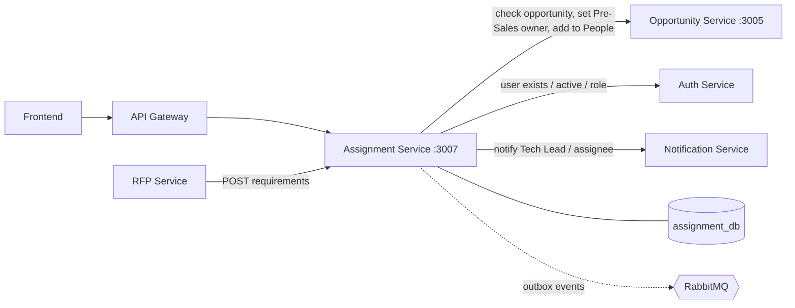
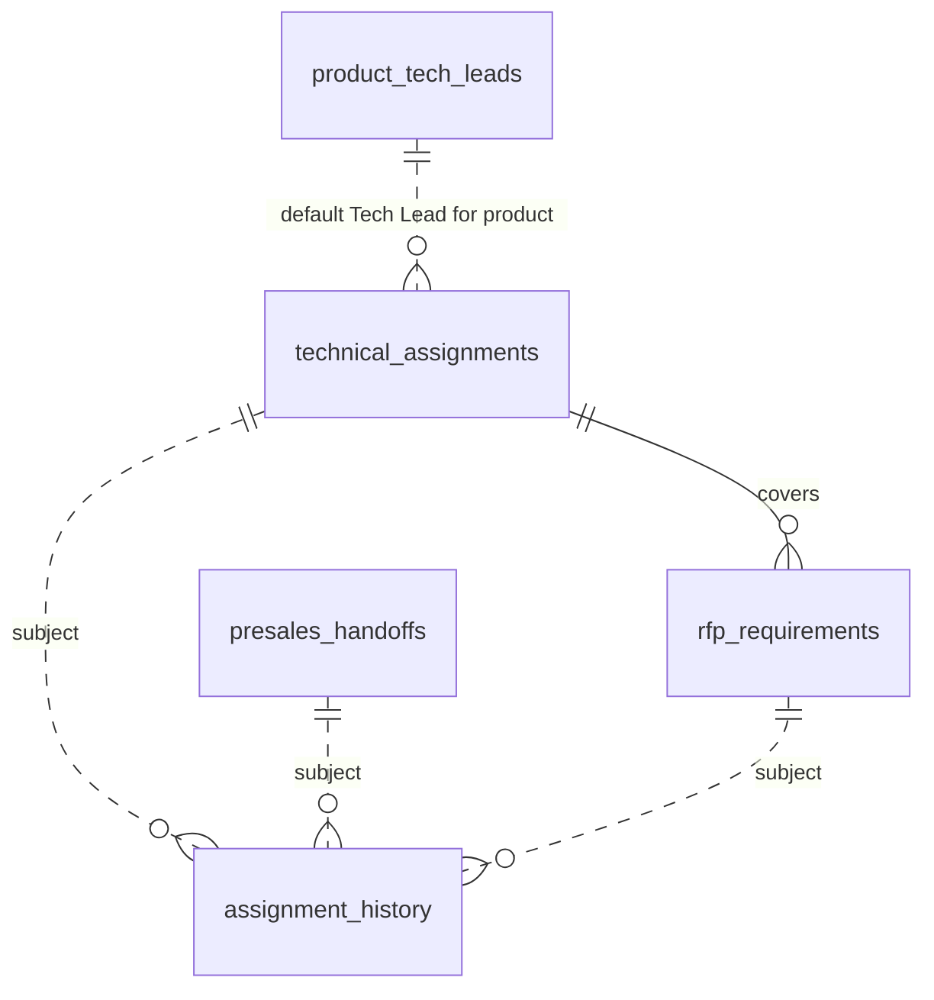
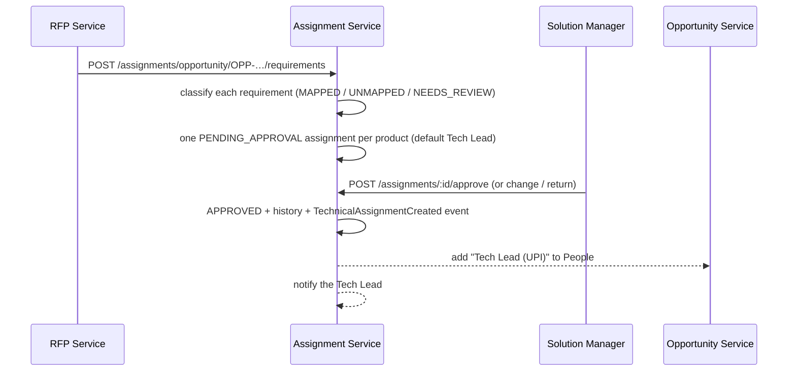
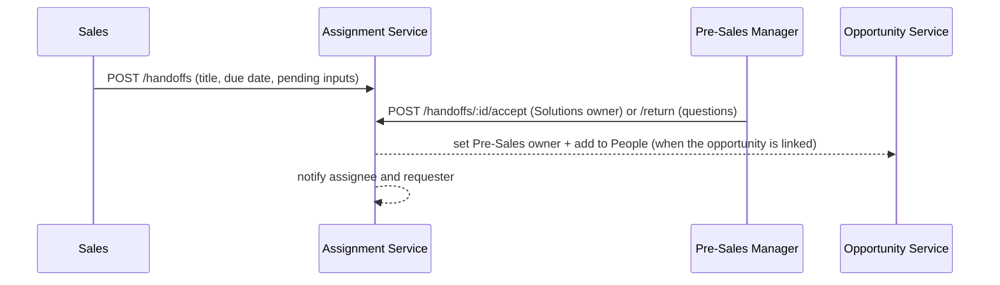

# Assignment Service: Architecture

## 1. Purpose and boundaries

From the PRD and the team's architecture notes ("Assignment Service: product/vertical mappings and technical lead assignments"):

| Owns | Does not own |
|---|---|
| **Product → default Tech Lead** master (and product vertical TSP/EVOK) | Users and roles → Auth Service |
| **Technical assignments**: RFP requirements → product workstream → Tech Lead, with Solution Manager approval (PRD US-15) | Opportunity owner, contributors, stage → Opportunity Service |
| **Review queue** for unmapped / unclear requirements | RFP extraction and confirmation → RFP Service |
| **Sales → Pre-Sales handoffs** (PRD Step 5): Solutions owner, status, due date, pending inputs | Compliance SME assignments → Compliance Service |
| History of every assignment action, and outbox events | Sending Teams / email → Notification Service |

The opportunity's **Pre-Sales owner** and **People** list are stored in the Opportunity Service. This service **updates them through its API** when a handoff is accepted or a Tech Lead is approved, so the frontend keeps reading a single place.

## 2. Where it sits



Every outgoing call goes through a client in `src/integrations/` with a **mock** and a **real** version. The env URL decides which one is used, and `/health` shows it:

| Client | Today |
|---|---|
| Opportunity | **real** (`OPPORTUNITY_SERVICE_URL`), mock if unset |
| Auth, RFP, Notification | mock until those services exist; then set the URL |

## 3. Inside the service

```
src/
├── main.ts, app.setup.ts, app.module.ts     one Nest module, Swagger at /api/docs
├── product-verticals/   controller · service · dto     → product_tech_leads
├── assignments/         controllers · service · dto · requirement-rules.ts
│                        → technical_assignments, rfp_requirements
├── handoffs/            controller · service · dto     → presales_handoffs
├── history/             history.service.ts             → assignment_history
├── events/              assignment-event.publisher.ts  → assignment_domain_events (outbox)
├── integrations/        users · opportunity · rfp · notification clients (+ mocks)
├── common/              statuses.ts · validation.ts · lookup.service.ts · error filter · x-user-id
├── entities/  migrations/  config/  database/
```

Request flow: **controller** (route, `x-user-id`) → **service** (rules) → **one DB transaction** (row + history + event) → **after commit**: notify and sync the opportunity (failures become `warnings`, never undo the action).

### Design decisions
1. **One assignment per opportunity + product** (not per requirement). The Solution Manager approves "UPI → Asha" once for all UPI requirements. Unique key `(opportunity_id, product_tsp)`.
2. **Review rules are one pure function** (`requirement-rules.ts`): no product → UNMAPPED; several products or no usable default lead → NEEDS_REVIEW; otherwise MAPPED. They're easy to read, test and change.
3. **Status changes lock the row** and check the status on the locked row. Two simultaneous approvals: one wins, the other is rejected (409 or 400).
4. **History keeps every version**: each action stores a `snapshot`, so proposed and final Tech Leads are both kept (PRD requirement).
5. **Side effects after commit**: notifications and the Opportunity sync run after the database change is saved. If they fail, the response includes `warnings` and the outbox event remains the reliable record.
6. **Idempotent intake**: re-sending a requirement with the same `requirementRef`, or running auto-assign again, creates nothing twice.
7. **No cross-service foreign keys**: opportunity and user ids are stored as values (plus a display name, since Auth isn't built yet).

## 4. Data model (`assignment_db`)



| Table | Key columns |
|---|---|
| `product_tech_leads` | `product_tsp` (unique), `vertical`, `tech_lead_user_id/name`, `active` |
| `technical_assignments` | `opportunity_id + product_tsp` (unique), `status`, `proposed_tech_lead_*`, `tech_lead_*` (final), `version`, `decided_by/at`, `notified_at` |
| `rfp_requirements` | `opportunity_id`, `requirement_ref`, `title`, `product_tsp` (null = unmapped), `status`, `review_reason`, `technical_assignment_id` (FK) |
| `presales_handoffs` | `opportunity_id / lead_id / synopsis_id`, `status`, `requested_by_*`, `assignee_*`, `due_date`, `pending_inputs` (JSON), `return_note` |
| `assignment_history` | `subject_type + subject_id`, `action`, `from/to_status`, `actor_user_id`, `comment`, `snapshot` (JSON) |
| `assignment_domain_events` | `event_type`, `payload` (envelope), `published_at` (NULL = not sent) |

## 5. Flows

### Technical assignment (PRD US-15)


### Handoff (PRD Step 5)


## 6. Not built yet
| Item | Plan |
|---|---|
| Real Auth / Notification / RFP | Set the env URLs; adjust field mapping in the client file if their contracts differ |
| RabbitMQ publisher | Small job: read `published_at IS NULL`, publish, set `published_at` |
| Frontend screens | Solution Manager queue (`GET /assignments?status=PENDING_APPROVAL`), review queue, handoff accept/return on the RFP synopsis page |
| PRD open questions | Shared ownership rules, Solution Manager delegation, whether pending assignments block proposal progress |

---

## For you: the service in plain words

**What problem does it solve?**
When a bank sends an RFP, it contains many requirements: "UPI switch with 2,000 TPS", "BBPS biller onboarding", "quarterly DR drill"… Each one needs a **technical expert (Tech Lead)** from the right product team. Today that happens over Teams and email, and nobody can see who owns what.

**What the service does, step by step:**
1. **A master list** says "UPI → Asha, BBPS → Ravi". An admin maintains it, so nobody hard-codes names.
2. **The RFP's requirements arrive.** The service sorts them by product. Everything for UPI becomes one "UPI workstream", proposed to Asha.
3. **Anything unclear doesn't get guessed.** No product, two products, or a Tech Lead on leave goes to a **review queue** for a person to decide.
4. **The Solution Manager approves, changes or returns** each proposal. Nothing is final until approved.
5. **When approved:** the Tech Lead is told, and they appear in the opportunity's **People** panel.
6. **Separately, the handoff:** Sales asks Pre-Sales for help ("we need a solution for this RFP by 5 Dec, the NDA is still missing"). The Pre-Sales Manager accepts and names the **Solutions owner**, or sends it back with questions. That person then shows as the opportunity's **Pre-Sales owner**.

**Why it's built this way:**
| Choice | Reason |
|---|---|
| Mock / real clients | Work now without Auth, RFP or Notification; switch with one env variable later |
| One assignment per product | Fewer approvals for big RFPs, same as how teams are organised |
| Everything has a history | PRD asks to keep proposed and final versions; useful for audits |
| Opportunity data stays in the Opportunity Service | One source of truth: this service just updates it through the API |

**How to explain it in one sentence:**
*"The Assignment Service decides who works on what: it proposes Tech Leads for each RFP product, routes them through Solution Manager approval, and tracks the Sales → Pre-Sales handoff, keeping a full history and updating the opportunity automatically."*
