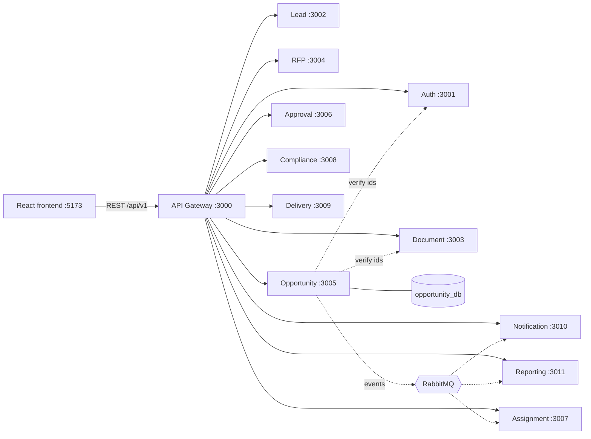
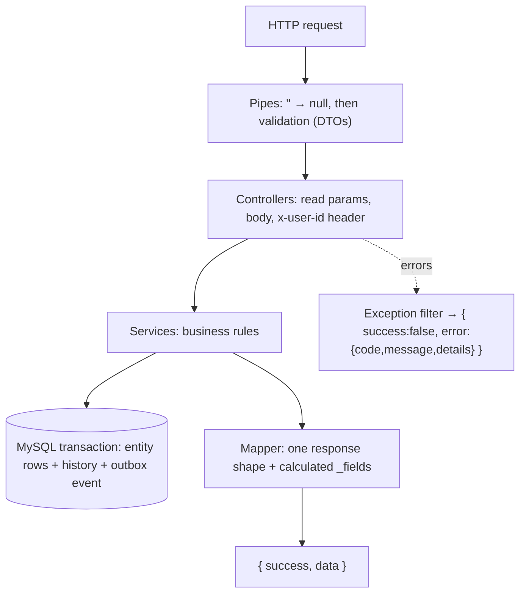
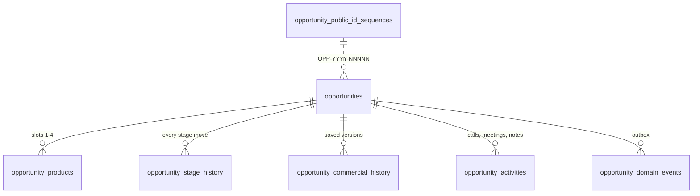
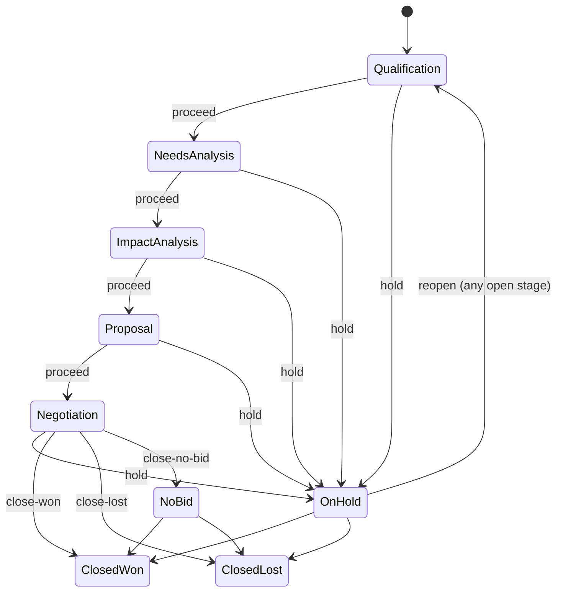

# Opportunity Service: Architecture

## 1. Where it sits in DealPlus

DealPlus is a sales CRM for NPST: lead → RFP → opportunity → proposal and approval → PO → delivery.
It's built as **12 NestJS apps in one monorepo** (`backend/apps/*`). Each service owns its own MySQL database.

**Rules every service follows** (`docs/architecture/microservices.md`):
- Each service owns its database. No joins or writes into another service's database.
- Services share **ids** and talk through **REST** (synchronous) or **events** (asynchronous, RabbitMQ).
- Critical changes use an **outbox**: the event is saved in the same transaction as the change, then published.

## 2. What the Opportunity Service owns

| Owns | Does not own (only stores the id) |
|---|---|
| The opportunity record: every field on the frontend Details tab | Users and roles → Auth (`ownerUserId`, `presalesUserId`) |
| Stage lifecycle: proceed, hold, reopen, close won / lost / no bid | Leads and accounts → Lead (`leadId`, `accountId`) |
| Product slots 1–4 and their modules | Files (PO, proposals) → Document (`poFileDocumentId`) |
| Revenue, FY27 phasing, calculated values | RFP synopsis → RFP · compliance → Compliance |
| Commercial lines and saved versions, PO receipt | Pre-PO evaluations, Post-PO projects → Delivery |
| Side panels: tasks, deal team, fallback plans | P&L recommendation and decisions → Approval |
| History timeline: stage moves and logged calls / meetings | Notifications (Teams / email) → Notification |

## 3. Inside the service

| Layer | Files | Job |
|---|---|---|
| Setup | `main.ts`, `app.setup.ts`, `app.module.ts` | Port, `/api/v1` prefix, pipes, error filter, CORS |
| Validation | `common/validation.ts`, `*/dto/*.ts` | One line per field: type, max length (= column size), allowed values |
| Field list | `opportunities/opportunity-fields.ts` | **The list of editable fields.** Drives create, update and response |
| Controllers | `*/*.controller.ts` | Thin: route → service, read the `x-user-id` actor |
| Services | `*/*.service.ts` | Rules; one update path (`OpportunitiesService.update`) |
| Stage engine | `stages/` | Rules ported from the frontend (`stage-field-rules.ts`), actions (`stage-transition.service.ts`) |
| Data | `entities/`, `migrations/`, `database/schema.sql` | TypeORM entities = tables. `synchronize` is off; migrations only |
| Events | `events/` | Writes outbox rows inside the same transaction |
| Errors | `common/http-exception.filter.ts` | One error format, MySQL errors mapped to 400/409, 500s logged |

### Key design decisions
1. **One field list, one update path.** Adding a field = schema + entity + one line in the field list + one DTO line. PATCH, `/revenue`, `/contributors` and `/products` all use `OpportunitiesService.update`.
2. **One response shape.** Every endpoint that returns an opportunity returns the same object, re-read from the database after saving.
3. **Stage actions are atomic and safe when requests overlap.** Lock the row, check the rules on that locked row, update, write the history row and the event, then commit. Two simultaneous "close won" requests: one wins, the other gets a 400.
4. **Frontend-friendly input.** `''` means empty, unknown fields are dropped, `null` clears a value.
5. **Who did it** comes from the `x-user-id` header (set by the gateway), with the body as a fallback.
6. **Outbox events** in `opportunity_domain_events` (`published_at IS NULL` = not sent yet). A publisher is added later without touching business code.
7. **Calculated values are never stored:** `_prob`, `_forecast`, `_amount`, `_tcv`, `_totalArr`, `_category`, FY27 totals.

## 4. Data model (`opportunity_db`)

| Table | Notes |
|---|---|
| `opportunities` | 130 columns, one per Details-tab field. JSON only for lists: `competitors`, `stage_tasks`, `deal_team`, `hold_fallbacks`, `current_commercial_lines`. Soft delete via `deleted_at` |
| `opportunity_products` | Unique `(opportunity_id, product_slot)`; `modules` is a JSON array |
| `opportunity_stage_history` | from → to, who, when, readable `narrative`, plus the outcome details (lost reason, hold, override, PO, billing) |
| `opportunity_commercial_history` | Snapshot of the lines at each saved version |
| `opportunity_activities` | History tab logs (Call / Meeting / Email / Note) |
| `opportunity_public_id_sequences` | Per-year counter; an upsert keeps ids unique when creates overlap |
| `opportunity_domain_events` | Outbox: envelope JSON, `published_at` |

Foreign keys exist **only inside** this database (`ON DELETE CASCADE`). Ids from other services have no foreign key.

## 5. Stage lifecycle

- **Close** is allowed from any open stage, On Hold or No Bid. The diagram shows only the main paths.
- **Proceed** needs the stage's required fields (e.g. Needs Analysis → `reqReceived = Yes`) and no open tasks for that stage.
- **Closing early**, while early-stage tasks are still open, needs `overrideReason` and `overrideJustification`.

| Stage | Probability | Forecast |
|---|---|---|
| Qualification / Needs Analysis / Impact Analysis | 10 / 25 / 40 % | Pipeline |
| Proposal | 60 % | Best Case |
| Negotiation | 80 % | Commit |
| Closed Won | 100 % | Closed |
| Closed Lost / No Bid / On Hold | 0 % | Omitted |

## 6. Integration points

| Direction | With | How | Status |
|---|---|---|---|
| In | Frontend, through the gateway | REST `/api/v1/opportunities/**` (see `../API.md`) | ✅ |
| In | Gateway | `x-user-id` header after login | ✅ read; gateway still to set it |
| Out | Auth | `GET {AUTH_SERVICE_URL}/api/v1/users/:id` to check owner / pre-sales | ✅ optional (env) |
| Out | Document | `GET {DOCUMENT_SERVICE_URL}/api/v1/documents/:id` to check the PO file | ✅ optional (env) |
| Out | Notification, Reporting, Assignment | Events from the outbox via RabbitMQ | ⏳ outbox ready, publisher not built |
| In | RFP | `SynopsisAccepted` → create an opportunity | ⏳ later |

## 7. Not built yet (in order)
1. Outbox publisher → RabbitMQ: poll `published_at IS NULL`, publish, set `published_at`.
2. Consumer for `SynopsisAccepted` (idempotent create).
3. Permission checks per role (the frontend has edit bands by stage) once the Auth Service gives roles.
4. Updating the frontend sync code to send all Details fields: frontend owner.

---

## For you: the project in plain words

**What is DealPlus?** NPST sells payment software (UPI, BBPS, IMPS…) to banks. A sale takes months.
DealPlus is the app the sales team uses to track each deal from the first conversation to the signed purchase order (PO).

**The journey of one deal**
1. A **lead** comes in, e.g. "Axis Bank may want a UPI switch". That's the Lead Service.
2. The bank sends an **RFP** document. It's uploaded (Document Service) and read (RFP Service).
3. The lead becomes an **opportunity**: a real deal with a value and a close date. **That's your service.**
4. The deal moves through **stages**: Qualification → Needs Analysis → Impact Analysis → Proposal → Negotiation.
   Each stage has a checklist, e.g. "SOW done = Yes". You can't move forward until it's filled.
5. It ends as **Closed Won** (PO received), **Closed Lost** (with a reason), **No Bid**, or sits **On Hold** with a plan to restart.
6. Along the way, other services handle approvals (P&L head), compliance, Pre-PO PoCs and delivery after the PO.

**What your service is, in one sentence:**
*the single source of truth for every deal: its details, money, products, stage and history.*

**How a request flows through your code** (example: the user clicks "Save & proceed"):
1. The frontend calls `POST /opportunities/OPP-2026-00001/stages/1/proceed`.
2. The **controller** reads the id and the user (`x-user-id`) and calls the **stage service**.
3. The service **locks the row**, checks the checklist for that stage, then saves the new stage
   and adds a **history row** ("Stage: Needs Analysis → Impact Analysis") and an **event** ("OpportunityStageChanged"), all in **one transaction**.
4. It re-reads the opportunity and returns it with calculated values: probability 40 %, forecast "Pipeline".

**Five ideas to remember (and explain to anyone):**
| Idea | Why it matters |
|---|---|
| Database per service | Teams work independently; you never touch another team's tables |
| One field list | Adding a field is a 4-line change, and nothing gets forgotten |
| Transaction + lock for stage moves | No double-closing, and history always matches reality |
| Outbox events | Other services can react later (notify, report) without slowing you down |
| One response shape and one error shape | Frontend and gateway code stay simple |

**Words you'll hear:** ARR = yearly recurring revenue · TCV = total contract value over all years ·
PO = purchase order (the bank's "yes, we're buying") · RFP = the bank's request for proposal ·
Pipeline / Best Case / Commit = how confident the forecast is.
