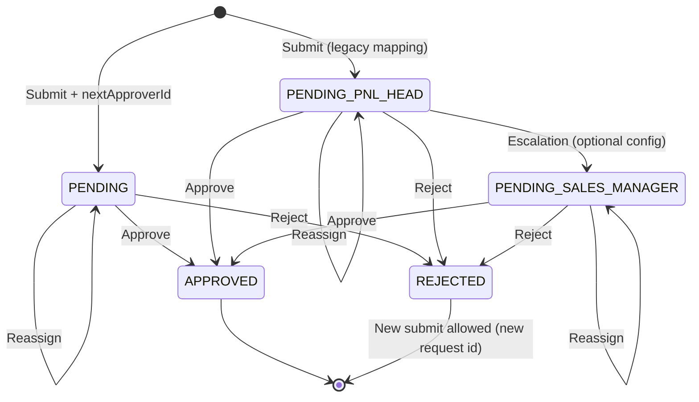

# Approval Service — implementation report

**Date:** 2026-11-25  
**PRD:** `docs/prd/NPST_Sales_Workflow_PRD_v1.0_Pre_Final.md` (US-18, lead approval-request tracking)  
**Service:** `backend/apps/approval-service`  
**Database:** `approval_db` (MySQL)

## Gap analysis (before work)

| Area | Prior state |
|------|-------------|
| Persistence | `InMemoryApprovalRepository` wired in `AppModule` despite TypeORM entities + initial migration |
| Submit API | No HTTP submit; domain-only `ApprovalLifecycleService.submit()` |
| Approver selection | Auto-resolved via product-vertical mapping (P&L Head), not explicit “choose next approver” |
| Reassign | Not implemented |
| List filters | No query filters (status, lead, requester, approver) |
| History types | No `APPROVER_SELECTED` / `REASSIGNED` |
| Status model | Only role-specific pendings (`PENDING_PNL_HEAD`, `PENDING_SALES_MANAGER`) |
| Tests | Strong lifecycle unit tests; no DB-backed repository tests in CI |
| `/decisions` | Alias approve/reject + deferred Sales recommendation — separate from lead approval tracking |

## PRD requirements implemented

| PRD flow step | Implementation |
|---------------|----------------|
| Submit for approval | `POST /approvals` + `ApprovalLifecycleService.submit()` |
| Choose next approver | `nextApproverId` on submit → status `PENDING`, role `ASSIGNED`, history `APPROVER_SELECTED` |
| Pending request | Statuses in `ACTIVE_APPROVAL_STATUSES`; `GET /approvals/pending` |
| Approve / Reject | `POST /approvals/:id/approve`, `POST /approvals/:id/reject` |
| Reassign | `POST /approvals/:id/reassign` with history `REASSIGNED` |
| Approval history | `GET /approvals/:id/history` (append-only events) |

**Kept separate (per PRD):** Lead approval-request tracking does not implement Sales Yes/No recommendation, P&L Proceed/Reject, or CXO governance. `/decisions` endpoints remain as-is with `501` for recommendation and aliases for approve paths (legacy).

## Architecture

```
approvals.controller.ts     HTTP (approvals/*)
decisions.controller.ts     HTTP (decisions/* — legacy alias)
approval-lifecycle.service.ts   Domain rules + events
typeorm-approval.repository.ts  approval_db persistence
approval-mapper.ts          Entity ↔ domain
mock/*                      Dev-only actor token + policy (not production IAM)
```



## Database

**Tables (existing + migration `1796000000001-ApprovalRequestTracking.ts`):**

| Table | Purpose |
|-------|---------|
| `approval_requests` | Request state, approver, lead reference, optimistic `version` |
| `approval_history_events` | Immutable audit trail |
| `decisions` | Terminal decision record (1:1 with decided request) |

**Migration `1796000000001`:**

- Adds status `PENDING`, authority role `ASSIGNED`
- Adds history types `APPROVER_SELECTED`, `REASSIGNED`
- Recreates generated `active_lead_key` for one active pending request per `lead_id`

**Run locally:**

```bash
cd backend
cp apps/approval-service/.env.example apps/approval-service/.env
# ensure MySQL approval_db exists
npm run migration:run:approval
```

**Env (see `.env.example`):** `DB_*` or `APPROVAL_DB_*`, `APPROVAL_DB_MIGRATE=true` to auto-run on startup.

## API endpoints

Base path: service root (gateway typically `/api/v1/approvals`).  
**Auth:** `x-mock-token` + `MockActorGuard` in dev only — production Command Module deferred.

| Method | Path | Description |
|--------|------|-------------|
| `POST` | `/approvals` | Create approval request (body: `parseSubmitApprovalInput`) |
| `GET` | `/approvals` | List (query: `status`, `leadId`, `requesterId`, `approverId`) |
| `GET` | `/approvals/pending` | Pending for current approver |
| `GET` | `/approvals/:id` | Get by id |
| `GET` | `/approvals/:id/history` | History |
| `POST` | `/approvals/:id/approve` | Approve (optional `comment`) |
| `POST` | `/approvals/:id/reject` | Reject (required `reason`) |
| `POST` | `/approvals/:id/reassign` | Reassign (`newApproverId`, optional `comment`) |
| `POST` | `/approvals/:id/request-changes` | `501` not implemented |

**Submit body (JSON):**

```json
{
  "leadId": "uuid",
  "creatorId": "actor-id",
  "creatorRole": "SALES_REPRESENTATIVE",
  "productVertical": "UPI",
  "teamId": "team-1",
  "territoryId": "territory-1",
  "idempotencyKey": "unique-key",
  "nextApproverId": "actor-id-of-approver"
}
```

If `nextApproverId` is omitted, legacy mapping selects P&L Head (`PENDING_PNL_HEAD`).

**Reassign body:**

```json
{
  "newApproverId": "actor-id",
  "comment": "optional"
}
```

**Headers:** `Idempotency-Key` recommended on approve/reject/reassign (defaults generated if absent).

## State transitions & validation

| Rule | Enforcement |
|------|-------------|
| One active request per lead | DB unique `active_lead_key` + domain check |
| Idempotent submit | Unique `submission_idempotency_key` |
| Only pending can decide/reassign | `ACTIVE_APPROVAL_STATUSES` check |
| Terminal cannot decide again | Status + `decision_id` |
| Only current approver may approve/reject | `assertActionAccess` |
| Reassign allowed for creator, current approver, admin | `MockApprovalPolicy.canReassign` |
| Reject requires `reason` | `parseRejectApprovalInput` |
| Optimistic concurrency | `version` on commits |

## Tests

| Suite | Result |
|-------|--------|
| `backend/test/approval-lifecycle.service.spec.ts` | **32 passed** (in-memory repository harness) |
| Full `npm run verify` | **165 passed** (includes approval suite) |
| DB persistence after restart | **Not run in CI** — requires MySQL; use `migration:run:approval` + manual restart smoke |

**New cases:** explicit `nextApproverId`, reassignment history, terminal reassignment rejected.

## Authentication / authorization (deferred)

| Item | Status |
|------|--------|
| Command Module / JWT | Not implemented (per task scope) |
| Production RBAC | Policy interface `ApprovalPolicy`; replace `MockApprovalPolicy` + `MockActorGuard` |
| Actor identity | `creatorId`, `currentApproverId`, `actorId` on history — opaque string IDs |

## Unresolved PRD / product decisions

1. When is lead approval mandatory vs optional? (PRD TBD)  
2. Shared approval capability vs separate workflows per gate? (open question #14)  
3. Reassignment authority in production IAM (who may reassign beyond creator/current approver/admin stub)  
4. Optional time-based escalation to Sales Manager — still config-driven (`APPROVAL_ESCALATION_*`), not PRD-mandated  
5. Relationship between `/decisions` “Proceed/Reject” and lead approval — **not unified**; separate tracks required  
6. Integration: Lead Service `ApprovalIntegration` still logs only; HTTP client to `POST /approvals` not in this task  

## Remaining issues

| Severity | Item |
|----------|------|
| Blocked locally | MySQL not running in dev environment — migration not executed here (`ECONNREFUSED :3306`) |
| Partial | No automated integration test against `approval_db` in default `npm test` |
| Partial | `DealplusAuthModule` registered but approval routes use mock actor guard |
| Documented | `POST /decisions/:id/recommendation` → `501` (Sales recommendation not in this service) |

## Definition of done checklist

| Criterion | Status |
|-----------|--------|
| Service builds | **PASS** |
| Connects to `approval_db` (TypeORM in `AppModule`) | **PASS** (code); **run migration on DB** for runtime |
| Persist requests | **PASS** (`TypeOrmApprovalRepository`) |
| Pending / approve / reject / reassign | **PASS** |
| History preserved | **PASS** |
| Valid transitions | **PASS** (tests) |
| Unit tests | **PASS** |
| Survives restart | **Pending** — verify after migration + manual smoke |

## Summary

The Approval Service now uses **TypeORM + `approval_db`** for all request/history/decision persistence, exposes **HTTP submit and reassign**, supports **explicit approver selection** aligned with PRD tracking, and retains **legacy vertical mapping + optional escalation** for backward compatibility. Sales/P&L/CXO decision gates remain **out of scope** for this service. Run `npm run migration:run:approval` against `approval_db` before starting the service in a persistent environment.