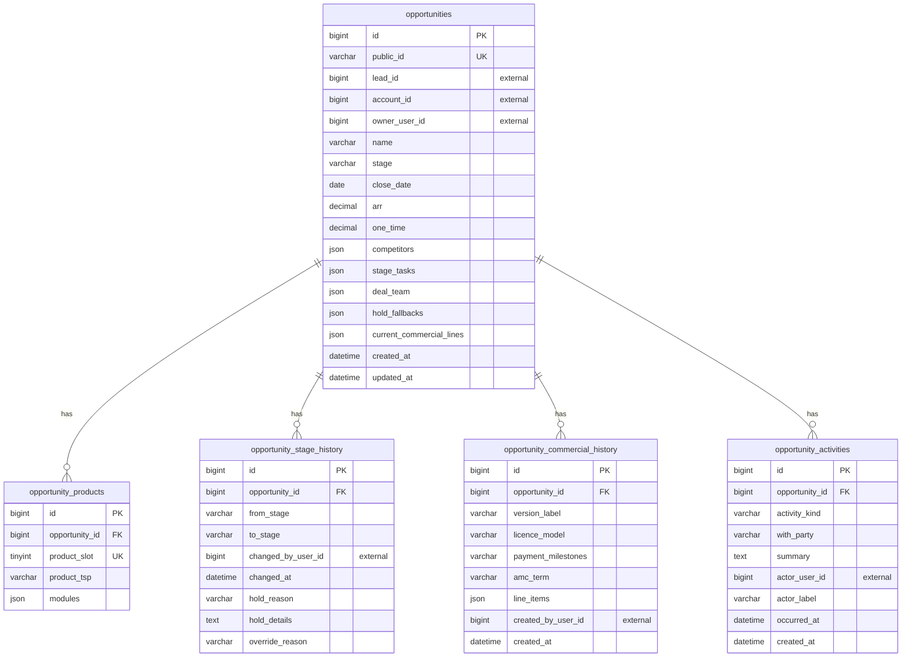

# Opportunity Service — MySQL database design

Source: [OPPORTUNITY_FIELD_MAPPING.md](./OPPORTUNITY_FIELD_MAPPING.md). Database: `opportunity_db` (per service ownership).

## ER diagram

## Table summary

| Table | Purpose |
|-------|---------|
| `opportunities` | All scalar Details-tab fields, commercial/PO header, hold/override state, FY27 phasing amounts; JSON only for true UI collections (competitors multi-select, tasks, deal team, hold fallbacks, editable commercial lines). |
| `opportunity_products` | Up to four product slots (`productTsp` … `productTsp4`) with multi-select modules per slot. |
| `opportunity_stage_history` | Every `MOVE_STAGE` (proceed, close won/lost, no bid, on hold, reopen) with outcome-specific columns. |
| `opportunity_commercial_history` | Immutable commercial version snapshots (`versions[]` + line unit prices per version). |
| `opportunity_activities` | History tab user logs (Call, Meeting, Email, Note) and narrative audit lines owned by this service (not stage transitions). |

## Derived fields (not stored)

Computed at read time to match frontend: `_forecast`, `_prob`, `_vertical`, `_amount`, `_tcv`, `_totalArr`, FY27 quarter totals and FY27 total (see mapping §4).

## External identifiers (no FK)

`lead_id`, `account_id`, `owner_user_id`, `presales_user_id`, `created_by_user_id`, `last_modified_by_user_id`, `changed_by_user_id`, `actor_user_id`, `po_file_document_id` — validated via Lead, Auth, and Document services.

## Artifacts

| Artifact | Path |
|----------|------|
| Raw SQL | `backend/apps/opportunity-service/database/schema.sql` |
| TypeORM entities | `backend/apps/opportunity-service/src/entities/` |
| Migration | `backend/apps/opportunity-service/src/migrations/` |

## JSON columns (UI-shaped collections only)

| Column | Frontend property | Rationale |
|--------|-------------------|-----------|
| `competitors` | `competitors[]` | Multi-select chip list |
| `stage_tasks` | `tasks[]` | Side panel task list |
| `deal_team` | `people[]` | Deal team members |
| `hold_fallbacks` | `fallbacks[]` | On-hold fallback / reopen entries |
| `current_commercial_lines` | `lines[]` with `p[]` version prices | Working commercial grid before snapshot |
| `opportunity_products.modules` | `module`, `module2`… | Modules per product slot |
| `opportunity_commercial_history.line_items` | One column per saved `versions[]` entry | Immutable revision snapshot |

## Not stored (other services)

Documents (`files[]`), proposal reviews, P&L `recDraft` / decisions, Pre-PO evaluations, compliance rows, and RFP synopsis blobs remain outside `opportunity_db`.