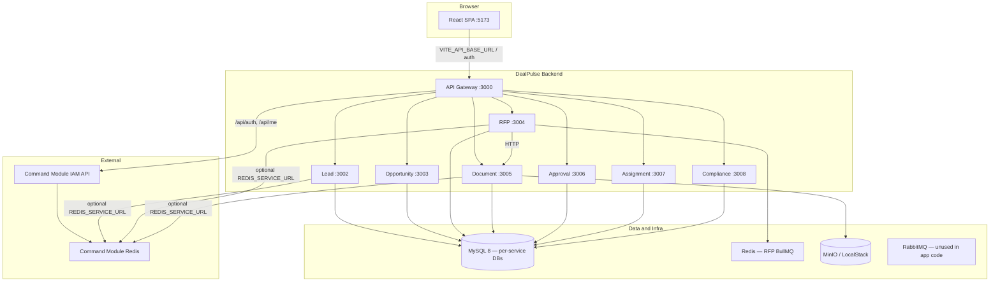

# Project Overview

**Analysis date:** 2026-11-25 · **Branch reviewed:** `integration` / `main` (includes merged `feature/rfp-service`) · **Method:** Read-only inspection of source, migrations, and config templates. Service health and runtime behavior are **NOT VERIFIED** unless noted.

## What DealPulse is

DealPulse (DealPlus) is an enterprise **sales workflow** product for NPST: **lead → qualification → opportunity → RFP → assignment → approval → compliance → pre-PO / PO → post-PO**. The repository is a **monorepo**:

| Area | Path | Role |
|------|------|------|
| Frontend | `frontend/` | React 18 + Vite workflow UI (demo + API client stubs) |
| Backend | `backend/` | NestJS monorepo (12 Nest app entrypoints in `nest-cli.json`) |
| Infrastructure | `docker-compose.yml`, `backend/docker-compose.local.yml` | MySQL, Redis, RabbitMQ, MinIO/LocalStack, ClamAV |
| Docs | `docs/` | PRDs, env, API catalogue, this design pack |

## High-level system architecture

## Strategic decisions (verified in code)

1. **Authentication** is external: Command Module (`auth_gateway`) — see [Authentication](./07-authentication-authorization.md). In-repo `auth-service` is a **placeholder** (health only).
2. **One MySQL database per microservice** (`docker/mysql/init-databases.sql`); cross-service links use UUID columns, not cross-DB FKs.
3. **Document storage** uses `document_db` (see `docs/database/document-db-consolidation.md`).
4. **API Gateway** is an HTTP reverse proxy (`http-proxy-middleware`); it does not implement business logic.
5. **Inactive** in active product scope: Delivery, Notification, Reporting (health shells only).

## Repository maturity (as of this analysis)

| Layer | Status | Evidence |
|-------|--------|----------|
| Frontend UX | **IMPLEMENTED** (demo) | 10+ screens, rich Store reducer, `localStorage` |
| Frontend ↔ business APIs | **MISSING** | `services/*.js` exist; **no page imports** (grep pages/) |
| API Gateway | **PARTIALLY IMPLEMENTED** | Proxy + CORS + IAM paths; no edge auth |
| Lead / Document / RFP | **IMPLEMENTED** | Controllers, migrations, tests |
| Opportunity / Assignment / Compliance | **IMPLEMENTED** (API) | Controllers, migrations, integration tests in repo |
| Approval | **PARTIALLY IMPLEMENTED** | REST + Swagger; **in-memory** repository; DB migrations present but not wired in `AppModule` |
| Cross-service integration | **PARTIAL / MOCK** | Lead→Approval/Opportunity log-only; Assignment client mocks |
| Command Module session guards | **PARTIAL** | Enabled only when `REDIS_SERVICE_URL` is set |
| End-to-end product | **NOT VERIFIED** | UI and APIs not wired; multi-service startup not automated |

## Documentation pack purpose

Accurate **as-built** architecture and **gap analysis** for Phase 1 (discovery). Phases 2–6 (run, integrate, E2E, production) are described in [Roadmap](./13-implementation-roadmap.md) — **not executed** in this pass.

## Related reading

| Doc | Topic |
|-----|--------|
| [Executive summary](./14-executive-summary.md) | Leadership Q&A |
| [Implementation gaps](./10-implementation-gaps.md) | Status matrix |
| [Environment configuration](../environment-configuration.md) | Per-service `.env` |
| [Command Module](../command-module-integration.md) | IAM integration |