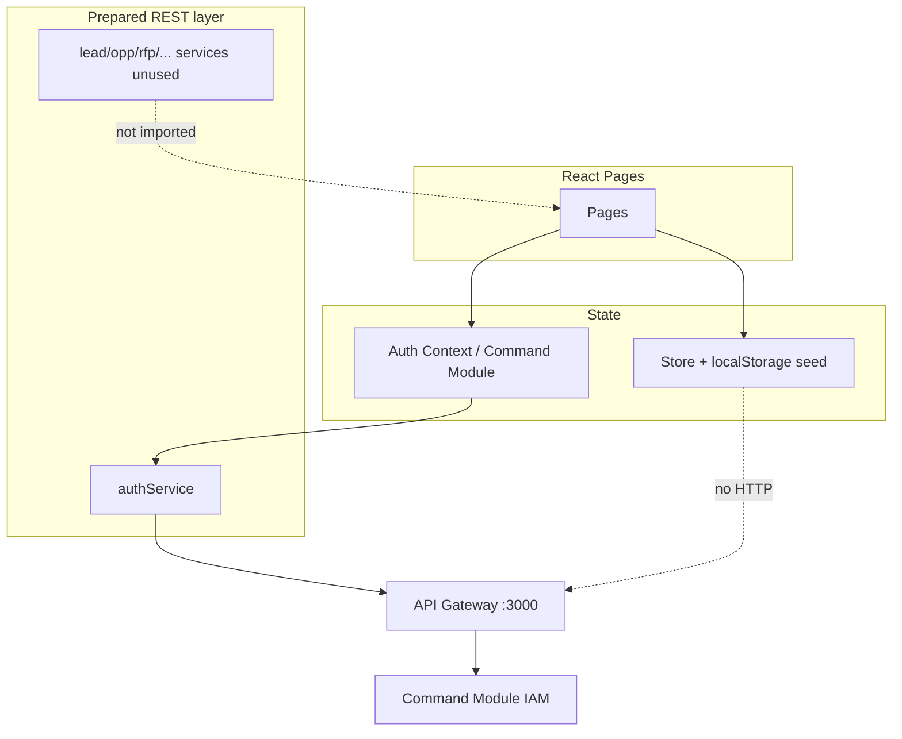

# Frontend Architecture

## Structure

```
frontend/src/
  pages/          # Route targets (10 screens + Login)
  components/     # Layout, forms, pickers, RfpExtract, Brand
  store/          # Auth.jsx (Command Module), Store.jsx (demo state)
  api/            # apiClient.js, endpoints.js
  services/       # auth + domain REST wrappers (mostly unused)
  data/           # seed.js, verticals.js, validators, mocks
  router.jsx      # Custom hash router
```

## Routing

Defined in `App.jsx` with hash paths:

| Path | Page | Layout |
|------|------|--------|
| (unauthenticated) | Login | No |
| `/` | Dashboard | Yes |
| `/leads` | Leads | Yes |
| `/leads/:id` | LeadDetail | Yes |
| `/rfp` | RfpSynopsis | Yes |
| `/opportunities` | Pipeline | Yes |
| `/opportunities/:id` | Opportunity | Yes |
| `/compliance` | Compliance | Yes |
| `/pre-po` | PrePO | Yes |
| `/decisions` | Decisions | Yes |
| `/post-po` | PostPO | Yes |

## State management

### Auth (`store/Auth.jsx`)

- **Command Module:** `authService` → `POST /api/auth/login`, `GET /api/me`, logout + CSRF.
- **Demo layer:** `VERTICALS` (`data/verticals.js`) for nav permissions (`can`), vertical picker, display fallbacks.
- Session vertical in `sessionStorage` (`dealpulse-vertical`).
- `switchTo()` changes vertical without re-auth (demo only).

### Business data (`store/Store.jsx`)

- **No API calls.**
- Initial state from `data/seed.js` + `oppExtras.js` + `defaults.js`.
- Persisted to **`localStorage`** key `dealpulse-demo-v14`.
- Reducer handles create/update lead, opportunity, compliance, teams messages, etc.

**PostPO** bypasses Store entirely; reads `seedPostPo` only.

## API layer (present but mostly disconnected)

| Module | Wired to UI? |
|--------|----------------|
| `services/authService.js` | **Yes** (Auth.jsx) |
| `services/leadService.js` | **No** |
| `services/opportunityService.js` | **No** |
| `services/documentService.js` | **No** |
| `services/rfpService.js` | **No** |
| `services/approvalService.js` | **No** |
| `services/assignmentService.js` | **No** |
| `services/complianceService.js` | **No** |
| `api/apiClient.js` | Used by services only; CSRF + `VITE_API_BASE_URL` |

Env (templates): `VITE_API_BASE_URL`, `VITE_AUTH_BASE_URL` → API Gateway.

## Mocks and placeholders

| Asset | Used by |
|-------|---------|
| `data/seed.js` | Store, Dashboard, Compliance, PostPO, Opportunity |
| `data/rfpMock.js` | `RfpExtract.jsx` (simulated extraction steps) |
| `data/verticals.js` | Login, Auth, Layout |
| `ContactPicker` / `EmailPicker` | Commented as mock pickers |

## Diagram

