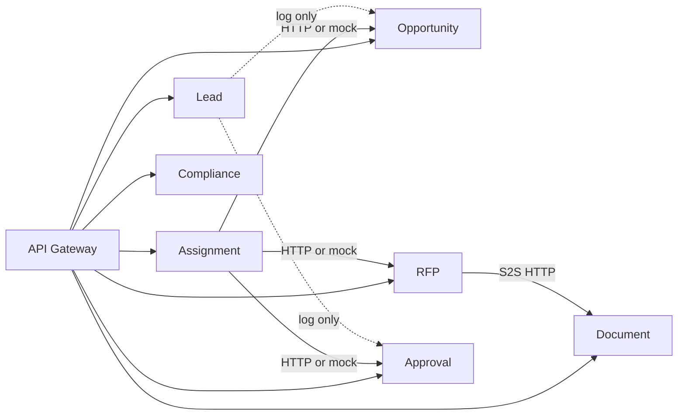

# Backend Microservices Architecture

**Conventions (verified):**

- Most services expose **`/api/v1`** (Compliance and Approval include Swagger at `/api/docs`).
- Per-service env: `backend/apps/<service>/.env` loaded via `loadServiceEnv()` or service-specific loaders (`assignment-service`, `opportunity-service`, `compliance-service`).
- `DealplusAuthModule` on several services; **passthrough guard** when `REDIS_SERVICE_URL` is unset (`libs/common/src/config/command-module.config.ts`).

## Backend microservices map

## Service catalogue

| Service | Default port | Database | Domain API | Status |
|---------|--------------|----------|------------|--------|
| api-gateway | 3000 | None | Proxy only | **PARTIAL** |
| auth-service | 3001 | — | Health | **PLACEHOLDER** |
| lead-service | 3002 | `lead_db` | Leads, qualification, history, lifecycle | **IMPLEMENTED** |
| opportunity-service | 3003 | `opportunity_db` | Opportunities, stages, products, PO, pipeline | **IMPLEMENTED** |
| rfp-service | 3004 | `rfp_db` | RFP CRUD, PDF, extraction, review | **IMPLEMENTED** |
| document-service | 3005 | `document_db` | Uploads, documents, versions, attachments | **IMPLEMENTED** |
| approval-service | 3006 | `approval_db` (migrations) | Approvals, decisions (Scope 1) | **PARTIAL** (in-memory persistence) |
| assignment-service | 3007 | `assignment_db` | Assignments, handoffs, requirements, product-verticals | **IMPLEMENTED** |
| compliance-service | 3008 | `compliance_db` | Frameworks, assessments, matrix, reviews | **IMPLEMENTED** |
| delivery-service | 3009 | — | Health | **PLACEHOLDER** |
| notification-service | 3010 | — | Health | **PLACEHOLDER** |
| reporting-service | 3011 | — | Health | **PLACEHOLDER** |

### API Gateway — port 3000

| Item | Detail |
|------|--------|
| Entry | `apps/api-gateway/src/main.ts` |
| Required env | `IAM_API_URL`, `LEAD_SERVICE_URL`, `DOCUMENT_SERVICE_URL`, `RFP_SERVICE_URL` |
| Proxied paths | See `apps/api-gateway/src/proxy/gateway-proxy.ts` |
| IAM | `/api/auth`, `/api/me`, `/api/public` → `IAM_API_URL` |
| Business | `/api/v1/leads`, `/documents`, `/uploads`, `/entity-documents`, `/rfps`, `/opportunities`, `/approvals`, `/decisions`, `/assignments`, **`/compliance`** |
| Gaps | No gateway auth enforcement; **Compliance routes are not under `/compliance` on the service** (see [API mapping](./05-api-inventory-mapping.md)); no rate limiting |

### Lead Service — `lead_db`

- **Controllers:** `leads`, `qualifications`, `history` (`apps/lead-service/src`).
- **Migrations:** `1795078209466-InitialLeadSchema.ts`.
- **Integrations:** `ApprovalIntegration`, `OpportunityIntegration` — **log-only stubs** (`integrations/*.ts`).
- **Auth:** Swagger Bearer noted; audit via `x-changed-by` header per README.
- **Tests:** Unit specs on controllers/services.

### Document Service — `document_db`

- Upload pipeline, ClamAV scan, MinIO/S3 storage, versions, entity attachments.
- **Migrations:** 2.
- **Deps:** MinIO/LocalStack, ClamAV, MySQL.
- **Tests:** Unit (file validation); integration breadth **NOT VERIFIED** in CI here.

### RFP Service — `rfp_db`

- Largest service: CRUD, document download, BullMQ PDF processing, rule-based extraction, amendment compare, review audit.
- **Migrations:** 5.
- **Deps:** Redis, Document Service HTTP client, optional Poppler/Tesseract on host.
- **Workers:** In-process BullMQ processors.
- **Tests:** Broad unit + env-gated integration specs.

### Opportunity Service — `opportunity_db`

- **IMPLEMENTED** in repo: `OpportunitiesController`, stages, products, commercials, contributors, activities, history, PO, pipeline, fallback, revenue.
- **Migrations:** `1732200000000-OpportunitySchema.ts`.
- **Env loading:** `load-env.ts` + `OPPORTUNITY_SERVICE_PORT` (`.env.example` uses `PORT=3003`).
- **Auth:** No `DealplusAuthModule` in `app.module.ts` (as reviewed).
- **Tests:** Jest config, controller/service specs, integration spec file present.

### Approval Service — `approval_db`

- **REST:** `ApprovalsController`, `DecisionsController`, Swagger, `MockActorGuard` + `x-mock-token` for Scope 1.
- **Persistence:** `InMemoryApprovalRepository` in `AppModule` — **not** TypeORM despite migrations under `src/database/migrations/`.
- **Events:** `InMemoryApprovalEventPublisher` (RabbitMQ planned per `DEPENDENCY_HANDLING.md`).
- **DealplusAuthModule:** Registered; session guard optional via Redis URL on other services pattern.
- **Status:** **PARTIALLY IMPLEMENTED** — API usable in dev; not production-durable.

### Assignment Service — `assignment_db`

- **Controllers:** assignments, requirements, handoffs, product-verticals, health with integration modes.
- **Migrations:** `1732300000000-AssignmentSchema.ts`.
- **Integrations:** `UsersClient`, `NotificationClient`, `RfpClient`, `OpportunityClient` — **mock when env URLs unset** (`integrations/*.ts`).
- **Tests:** Unit + route integration specs.

### Compliance Service — `compliance_db`

- Full MVP: frameworks, requirements, configurations, assessments, matrix, gap analysis, evidence, reviews, sign-offs.
- **Migrations:** `1732365300000-InitialComplianceSchema.ts`.
- **Auth:** No guards; actor via `X-Compliance-Actor-Id` header (`ACTOR_HEADER`).
- **Global prefix:** `/api/v1` on routes like `/frameworks`, `/assessments` — **not** `/api/v1/compliance/*`.

### Placeholder services

`auth-service`, `delivery-service`, `notification-service`, `reporting-service`: `AppModule` contains **HealthController only**.

## Shared libraries

| Path | Purpose |
|------|---------|
| `libs/common` | `service-env.ts`, `DealplusAuthModule`, `command-module.config` |
| `libs/command-module-auth` | `SessionAuthGuard`, Redis session reader |
| `libs/service-config` | DB env validation (Compliance) |
| `libs/security`, `libs/messaging` | **Empty / placeholder** |

## Configuration consistency issues (verified)

| Issue | Detail |
|-------|--------|
| Gateway vs Compliance paths | Gateway proxies only `/api/v1/compliance`; service exposes `/api/v1/frameworks`, `/assessments`, etc. |
| Opportunity port | Gateway default `3003`; `main.ts` falls back to `3005` if `OPPORTUNITY_SERVICE_PORT` and `PORT` unset — align `.env` |
| Approval DB | Migrations + `data-source.ts` exist; runtime uses in-memory repo |
| Document env | Some templates reference `dealplus_documents` vs `document_db` — consolidation doc applies |