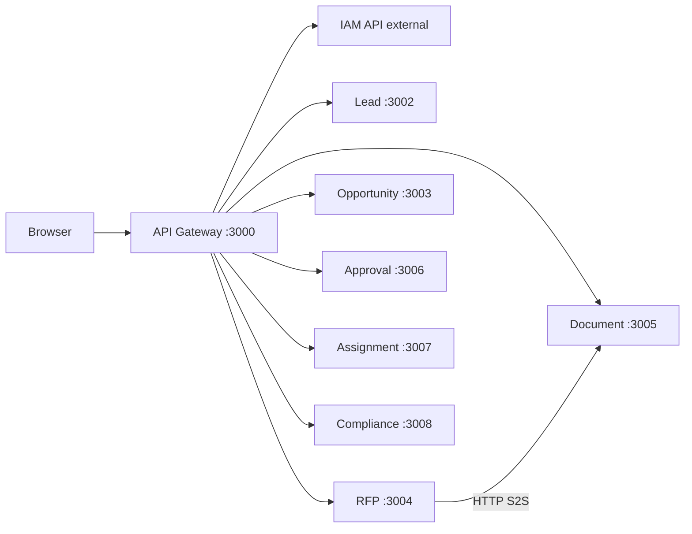

# Backend Microservices Architecture

Global conventions:

- Prefix: **`/api/v1`** on Nest apps (except gateway health and IAM proxy paths).
- Command Module auth: `DealplusAuthModule` when `REDIS_SERVICE_URL` set; else passthrough.
- Per-app env: `backend/apps/<service>/.env` (templates as `.env.example`).

## Active scope (configured)

### API Gateway — port 3000

| Item | Detail |
|------|--------|
| Purpose | Reverse proxy, CORS, IAM auth route proxy |
| DB | None |
| Status | **PARTIALLY IMPLEMENTED** |
| Implements | `HealthController`, `setupGatewayProxy`, env validation |
| Missing | Rate limits, correlation IDs, request auth at edge, stub upstream error UX |

Proxy table: see `apps/api-gateway/src/proxy/gateway-proxy.ts` and [Infrastructure](./08-infrastructure-deployment.md).

### Lead Service — port 3002, DB `lead_db`

| Item | Detail |
|------|--------|
| Purpose | Lead CRUD, qualification, history, lifecycle transitions |
| Status | **IMPLEMENTED** (core) |
| Entities | `Lead`, `LeadQualification`, `LeadHistory` |
| Migrations | `InitialLeadSchema` |
| Integrations | `ApprovalIntegration`, `OpportunityIntegration` — **log-only stubs** |
| Identity | `x-changed-by` header until Command Module permissions wired per action |
| Tests | Controller/service specs present |

### Document Service — port 3005, DB `document_db`

| Item | Detail |
|------|--------|
| Purpose | Upload, scan, MinIO storage, metadata, versions, entity attachments |
| Status | **IMPLEMENTED** |
| Entities | `Document`, `DocumentVersion`, `DocumentAttachment` |
| Migrations | 2 (initial + versions/attachments) |
| Deps | MinIO/S3, ClamAV, MySQL |
| Tests | File validation unit tests only |

### RFP Service — port 3004, DB `rfp_db`

| Item | Detail |
|------|--------|
| Purpose | RFP records, document associations, PDF text/OCR, rule-based extraction, review |
| Status | **IMPLEMENTED** (advanced) |
| Entities | 11 (rfp, jobs, pages, fields, amendments, etc.) |
| Migrations | 5 |
| Deps | Redis/BullMQ, Document Service HTTP client, Poppler/Tesseract (optional binaries) |
| Tests | Broad unit + optional integration (env-gated) |

### Opportunity Service — port 3003, DB `opportunity_db`

| Item | Detail |
|------|--------|
| Purpose | Opportunity pipeline (planned) |
| Status | **MOCK / PLACEHOLDER** — health + env only |
| Folders | `opportunities/`, `stages/`, etc. — `.gitkeep` |

### Approval Service — port 3006, DB `approval_db`

| Status | **MOCK / PLACEHOLDER** |

### Assignment Service — port 3007, DB `assignment_db`

| Status | **MOCK / PLACEHOLDER** |

### Compliance Service — port 3008, DB `compliance_db`

| Status | **MOCK / PLACEHOLDER** |

## Out of scope (in repo, inactive)

| Service | Port | Status |
|---------|------|--------|
| auth-service | 3001 | Health only; replaced by Command Module |
| delivery-service | 3009 | Health + empty dirs |
| notification-service | 3010 | Health + empty dirs |
| reporting-service | 3011 | Minimal health |

## Shared cross-cutting

| Concern | Implementation |
|---------|----------------|
| Auth guard | `libs/command-module-auth` + Redis session blob |
| Permission decorator | `RequirePermission` exists; **not used** on controllers |
| Messaging | `libs/messaging` empty; RabbitMQ in compose **unused in code** |
| JWT (`libs/security`) | **Not implemented** |