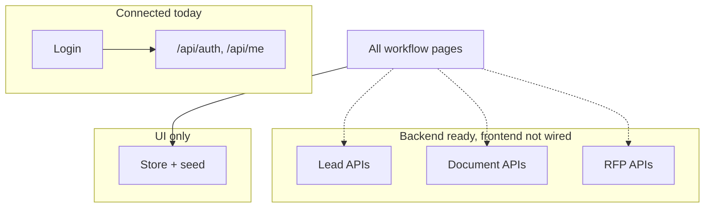

# API Inventory and Frontend Mapping

Base paths assume **API Gateway** at `http://localhost:3000`. Proposed-only routes are in `docs/api/api-catalog.md` (not implemented).

## Implemented backend APIs (verified controllers)

### Lead Service (`/api/v1/leads`…)

| Method | Path | Frontend screen | Connected? |
|--------|------|-----------------|------------|
| POST | `/leads` | Leads, LeadDetail | **No** (Store only) |
| GET | `/leads` | Leads | **No** |
| GET/PATCH/DELETE | `/leads/:id` | LeadDetail | **No** |
| POST | lifecycle routes (`working`, `assess-need`, `approve`, …) | LeadDetail | **No** |
| POST/GET/PATCH | `/leads/:id/qualification` | LeadDetail | **No** |
| GET | `/leads/:id/history` | LeadDetail | **No** |

### Document Service

| Method | Path | Frontend | Connected? |
|--------|------|----------|--------------|
| POST | `/uploads` | (would support RFP upload) | **No** |
| GET/PATCH/DELETE | `/documents/:id` | — | **No** |
| GET | `/documents`, `/entity-documents` | — | **No** |
| Versions / attachments | nested under `/documents` | — | **No** |

Frontend RFP extract uses **`rfpMock.js`**, not document APIs.

### RFP Service

| Area | Paths | Frontend | Connected? |
|------|-------|----------|--------------|
| RFP CRUD | `/rfps` | RfpSynopsis (mock synopsis in Store) | **No** |
| Documents | `/rfps/:id/documents/...` | RfpExtract mock | **No** |
| PDF processing | `/rfps/:id/documents/:docId/...` | — | **No** |
| Extraction / review | `/rfps/:id/...` (extraction module) | — | **No** |

### Stub services (gateway routes exist; no business controllers)

| Prefix | Screens using demo data | Backend |
|--------|-------------------------|---------|
| `/opportunities` | Pipeline, Opportunity | **404** if called |
| `/approvals`, `/decisions` | Decisions, Lead approve UX | **404** |
| `/assignments` | Teams, assignment UI in Store | **404** |
| `/compliance` | Compliance | **404** |

### Command Module (proxied, not in DealPlus repo)

| Method | Path | Frontend | Connected? |
|--------|------|----------|--------------|
| POST | `/api/auth/login` | Login | **Yes** |
| GET | `/api/me` | Auth boot | **Yes** |
| POST | `/api/auth/logout` | Layout logout | **Yes** (if wired in Layout—verify UI button) |

## Frontend screen → data source summary

| Screen | Primary data | Backend API |
|--------|--------------|-------------|
| Login | Command Module + VERTICALS | Auth **connected** |
| Dashboard | Store + seed | None |
| Leads / LeadDetail | Store + localStorage | **Unconnected** (`leadService` unused) |
| Pipeline / Opportunity | Store | **Unconnected** |
| RfpSynopsis | Store + rfpMock | **Unconnected** |
| Compliance | Store + seed templates | **Unconnected** |
| PrePO / Decisions | Store | **Unconnected** |
| PostPO | seedPostPo | **Unconnected** |

## Gateway vs catalogue gaps

`docs/api/api-catalog.md` lists accounts, contacts, pre-po, post-po, notifications, etc. **None** have matching Nest controllers in active services.

