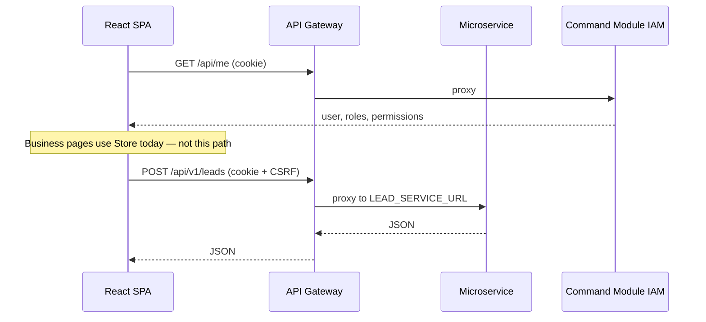
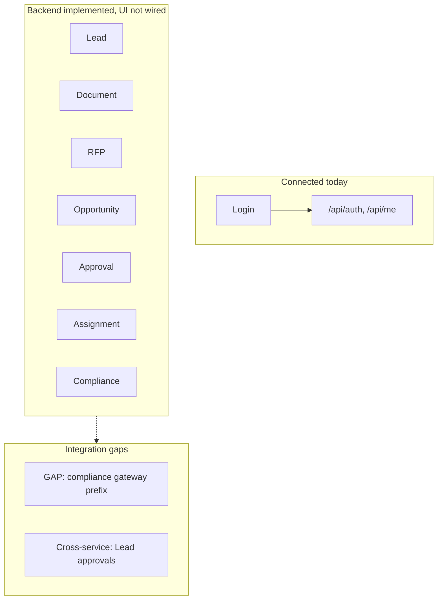

# API Inventory and Frontend Mapping

Gateway base: `http://localhost:3000` (see `frontend/.env.example`). Business APIs use prefix `/api/v1` on each service; gateway strips nothing except IAM paths.

## API communication flow

## Gateway route table (from `gateway-proxy.ts`)

| Incoming path | Upstream env | Service default port |
|---------------|--------------|----------------------|
| `/api/auth`, `/api/me`, `/api/public` | `IAM_API_URL` | external |
| `/api/v1/leads` | `LEAD_SERVICE_URL` | 3002 |
| `/api/v1/opportunities` | `OPPORTUNITY_SERVICE_URL` | 3003 |
| `/api/v1/rfps` | `RFP_SERVICE_URL` | 3004 |
| `/api/v1/documents`, `/uploads`, `/entity-documents` | `DOCUMENT_SERVICE_URL` | 3005 |
| `/api/v1/approvals` | `APPROVAL_SERVICE_URL` | 3006 |
| `/api/v1/decisions` | `APPROVAL_SERVICE_URL` | 3006 |
| `/api/v1/assignments` | `ASSIGNMENT_SERVICE_URL` | 3007 |
| `/api/v1/compliance` | `COMPLIANCE_SERVICE_URL` | 3008 |

**Routing gap (verified):** Compliance controllers use paths such as `/api/v1/frameworks`, `/api/v1/assessments`, `/api/v1/configurations` — **not** under `/api/v1/compliance`. Calls to `/api/v1/compliance/*` via gateway will **not** reach those handlers unless paths are added to the gateway or a global prefix is introduced on the service.

## Implemented backend APIs (controllers present)

### Lead Service

| Method | Path | Frontend | Wired? |
|--------|------|----------|--------|
| CRUD + lifecycle | `/api/v1/leads`, `/leads/:id/...` | Leads, LeadDetail | **No** |
| Qualification | `/api/v1/leads/:id/qualification` | LeadDetail | **No** |
| History | `/api/v1/leads/:id/history` | LeadDetail | **No** |

### Document Service

| Method | Path | Frontend | Wired? |
|--------|------|----------|--------|
| POST | `/api/v1/uploads` | (RFP upload UX) | **No** |
| CRUD / versions / attachments | `/api/v1/documents/...`, `/entity-documents` | — | **No** |

### RFP Service

| Area | Paths | Frontend | Wired? |
|------|-------|----------|--------|
| CRUD | `/api/v1/rfps` | RfpSynopsis (Store) | **No** |
| Documents / PDF / extraction | nested under `/rfps/:id` | RfpExtract mock | **No** |

### Opportunity Service

| Area | Paths | Frontend | Wired? |
|------|-------|----------|--------|
| CRUD + list + pipeline | `/api/v1/opportunities` | Pipeline | **No** |
| Stages, products, commercials, PO, etc. | `/api/v1/opportunities/:id/...` | Opportunity | **No** |

### Approval Service

| Area | Paths | Frontend | Wired? |
|------|-------|----------|--------|
| Approvals | `/api/v1/approvals` | Decisions, lead approval UX | **No** |
| Decisions | `/api/v1/decisions` | Decisions | **No** |
| Auth | `x-mock-token` header (Scope 1) | — | N/A |

### Assignment Service

| Area | Paths | Frontend | Wired? |
|------|-------|----------|--------|
| Assignments, requirements | `/api/v1/assignments`, `/requirements` | Teams / Store | **No** |
| Handoffs, product-verticals | `/api/v1/handoffs`, `/product-verticals` | — | **No** |

### Compliance Service

| Area | Paths | Gateway today | Wired? |
|------|-------|---------------|--------|
| Frameworks | `/api/v1/frameworks` | **No** (`/compliance` only) | **No** |
| Assessments, matrix, reviews | `/api/v1/assessments/...` | **No** | **No** |

### Command Module (proxied)

| Method | Path | Frontend | Wired? |
|--------|------|----------|--------|
| POST | `/api/auth/login` | Login | **Yes** |
| GET | `/api/me` | Auth boot | **Yes** |
| POST | `/api/auth/logout` | Layout (if bound) | **Partial** — verify button |

## Frontend service modules (`frontend/src/services/`)

All domain services use `apiFetch` + `endpoints.js` — **none are imported from `pages/`** (verified grep). Only `authService.js` is used from `Auth.jsx`.

## Screen → data source

| Screen | Data today | Target API (exists?) |
|--------|------------|----------------------|
| Login | Command Module | Yes |
| Dashboard | Store seed | Lead/Opp aggregates — APIs exist, not wired |
| Leads / LeadDetail | Store + localStorage | Lead Service — **yes** |
| Pipeline / Opportunity | Store | Opportunity Service — **yes** |
| RfpSynopsis | Store + `rfpMock` | RFP + Document — **yes** |
| Compliance | Store templates | Compliance Service — **yes** (gateway path gap) |
| Decisions | Store | Approval Service — **yes** |
| PrePO / PostPO | Store / static seed | **Missing** dedicated service |

## Proposed catalogue vs code

`docs/api/api-catalog.md` lists accounts, contacts, notifications, pre-po/post-po APIs — **no matching Nest controllers** in active services (catalogue is **aspirational**).

