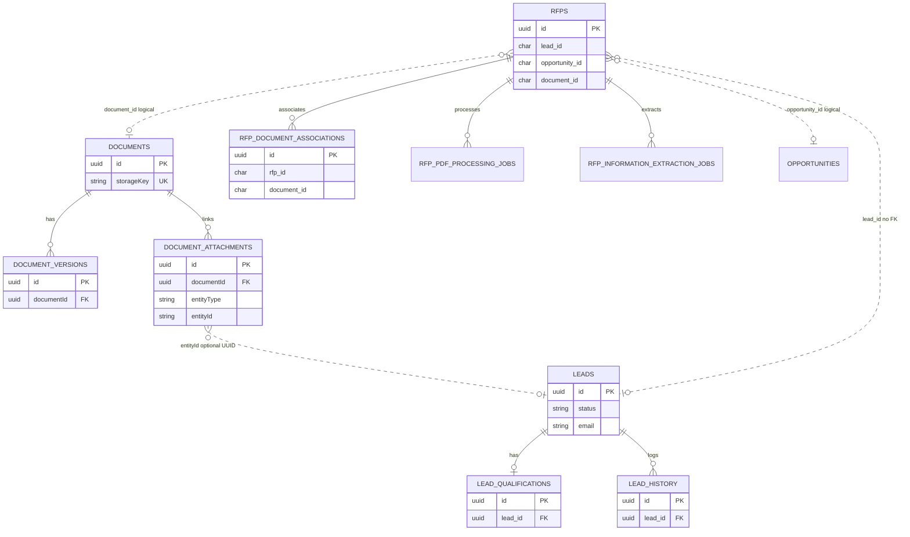

# Database Architecture

Analysis from **entities and migrations in source** only. Row counts and live schema on Aiven are **NOT VERIFIED** in this documentation pass (see consolidation doc for historical merge facts).

## Ownership (target)

| Database | Owning service | Migrations in repo | ORM |
|----------|----------------|-------------------|-----|
| `lead_db` | Lead Service | Yes (1) | TypeORM |
| `document_db` | Document Service | Yes (2) | TypeORM |
| `rfp_db` | RFP Service | Yes (5) | TypeORM |
| `opportunity_db` | Opportunity | **No** | Planned |
| `approval_db` | Approval | **No** | Planned |
| `assignment_db` | Assignment | **No** | Planned |
| `compliance_db` | Compliance | **No** | Planned |
| `iam_db` | Command Module (Postgres, external) | N/A | External |

**Obsolete:** `dealplus_documents` — removed per `docs/database/document-db-consolidation.md`; configs now use `document_db`.

**No cross-database FKs** (architectural rule in `ownership.md`). Cross-service links use UUID columns (`lead_id`, `opportunity_id`, `document_id`) validated via APIs.

## document_db (Document Service)

### Tables (from migrations + entities)

| Table | PK | FKs |
|-------|----|----|
| `documents` | `id` UUID | — |
| `document_versions` | `id` UUID | `documentId` → `documents.id` CASCADE |
| `document_attachments` | `id` UUID | `documentId` → `documents.id` CASCADE |
| `migrations` | TypeORM | — |

Notable columns on `documents`: `storageKey` (unique), `leadId` (legacy), `currentVersionNumber`, `checksumSha256`.

## lead_db (Lead Service)

| Table | PK | Relationships |
|-------|----|----------------|
| `leads` | UUID | 1:1 qualification, 1:N history |
| `lead_qualifications` | UUID | → lead |
| `lead_history` | UUID | → lead |

Large column set on `leads` (company, addresses, workflow fields) per `lead.entity.ts`.

## rfp_db (RFP Service)

| Table / entity | Purpose |
|----------------|---------|
| `rfps` | Core RFP; optional `lead_id`, `opportunity_id`, `document_id` |
| `rfp_document_associations` | Links RFP ↔ document UUIDs |
| `rfp_document_versions` | Version tracking |
| `rfp_pdf_processing_jobs`, `rfp_pdf_page_text` | PDF pipeline |
| `rfp_information_extraction_jobs` | Extraction jobs |
| `rfp_extracted_fields`, `rfp_field_mapping_config` | Extracted data |
| `rfp_field_review_audit` | Review audit |
| `rfp_amendment_*` | Amendment comparison |

FKs are **within rfp_db** only (see migration files).

## ER diagram (verified relationships only)

`OPPORTUNITIES` is **logical only**—no `opportunity_db` schema in repo yet.

## Migration status

| Service | CLI scripts (package.json) | synchronize |
|---------|---------------------------|-------------|
| Lead | `migration:lead:*` | false |
| Document | `migration:run` etc. | false |
| RFP | `migration:run:rfp` | false |
| Stubs | None | N/A |

## Configuration notes

- Document Service: `DB_NAME=document_db` in `.env.example` and consolidation docs.
- Duplicate env anti-pattern was fixed in `.env.documents.local` (single `DB_NAME`; analysis from templates, not reading gitignored secrets).