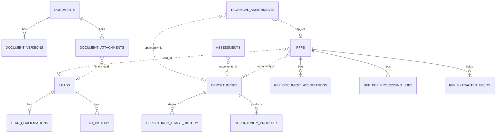

# Database Architecture

Schema derived from **migrations and entities in source** only. Live managed MySQL (e.g. Aiven) alignment is **NOT VERIFIED** in this pass.

## Database ownership

| Database | Service | Migrations in repo | Runtime ORM |
|----------|---------|-------------------|-------------|
| `lead_db` | Lead | Yes (`InitialLeadSchema`) | TypeORM |
| `opportunity_db` | Opportunity | Yes (`OpportunitySchema`) | TypeORM |
| `rfp_db` | RFP | Yes (5 files) | TypeORM |
| `document_db` | Document | Yes (2 files) | TypeORM |
| `approval_db` | Approval | Yes (`InitialApprovalSchema`) | Migrations only; **runtime in-memory** |
| `assignment_db` | Assignment | Yes (`AssignmentSchema`) | TypeORM |
| `compliance_db` | Compliance | Yes (`InitialComplianceSchema`) | TypeORM |
| `iam_db` | Command Module | External (Postgres) | N/A |

Local bootstrap: `docker/mysql/init-databases.sql` creates all seven MySQL databases and grants `dealplus` user.

**Rule:** No cross-database foreign keys. References to other services use UUID/string columns validated via HTTP.

## Per-service schema (summary)

### lead_db

- **Tables:** `leads`, `lead_qualifications`, `lead_history` (+ TypeORM migrations table).

### opportunity_db

- **Entities:** `opportunity`, stage history, products, commercials, activities, domain events, public id sequence (see `apps/opportunity-service/src/entities/`).

### document_db

- **Tables:** `documents`, `document_versions`, `document_attachments`.

### rfp_db

- **Tables:** `rfps`, document associations/versions, PDF jobs/page text, extraction jobs/fields, field mapping, review audit, amendment comparison/diffs.

### assignment_db

- **Entities:** technical assignments, RFP requirements, presales handoffs, product tech leads, assignment history, domain events (see `apps/assignment-service/src/entities/`).

### compliance_db

- **Domain:** frameworks, requirements, configurations, assessments, matrix entries, evidence refs, reviews, sign-offs (see compliance migrations SQL/TS).

### approval_db

- **Migrations define:** `approval_request`, `decision`, `approval_history_event` (names per migration file).
- **Runtime:** Approval service uses **in-memory** maps, not these tables, until repository implementation switches to TypeORM.

## ER diagram (logical cross-service links)

Physical FKs exist **within** each database only. Dashed lines are **logical** references (UUID columns).

## Configuration notes

| Topic | Status |
|-------|--------|
| `document_db` vs legacy `dealplus_documents` | Consolidated per `docs/database/document-db-consolidation.md` |
| SSL (`DB_SSL_CA`, `ca.pem`) | Used by RFP, Compliance, templates; path relative to `backend/` cwd |
| Per-service `.env` | Required at `apps/<service>/.env` for Nest bootstrap on several services |
| Approval DB vs memory | **Inconsistent** — migrations exist but AppModule does not register TypeORM |

## Migrations commands (from `backend/package.json`)

| Service | npm script |
|---------|------------|
| Document | `migration:run`, etc. |
| Lead | `migration:lead:run` |
| RFP | `migration:run:rfp` |
| Approval | `migration:run:approval` |
| Opportunity | `opp:migrate` |
| Assignment | `asg:migrate` |
| Compliance | TypeORM CLI via `data-source.ts` (see service README) |