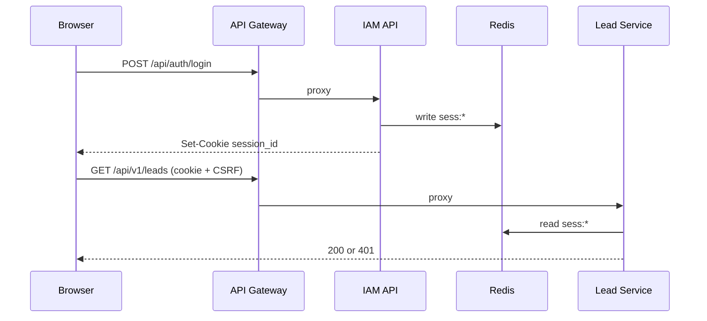

# Authentication and Authorization

## Model

DealPulse uses the external **Command Module** (`auth_gateway`), not `apps/auth-service`.

| Mechanism | Detail |
|-----------|--------|
| Login | `POST /api/auth/login` → `session_id` **httpOnly cookie** + `csrfToken` JSON |
| Session store | Redis keys `sess:{sessionId}` (iam-api writes; services read) |
| CSRF | `X-CSRF-Token` on unsafe methods |
| Profile | `GET /api/me` → roles, permissions array |
| IdP | Keycloak realm `auth_gateway` (external) |

See `docs/command-module-integration.md`.

## DealPlus backend integration

| Component | Status |
|-----------|--------|
| API Gateway proxy to `IAM_API_URL` | **IMPLEMENTED** |
| `libs/command-module-auth` | **IMPLEMENTED** (aligned with auth_shared) |
| `DealplusAuthModule` on active services | **IMPLEMENTED** |
| Enforcement | **PARTIAL** — `REDIS_SERVICE_URL` empty → **PassthroughAuthGuard** (all routes open) |
| `@RequirePermission` on controllers | **MISSING** (decorator exists, unused) |
| Permission registration `dealplus` app in IAM | **MISSING** (requires IAM team) |
| `libs/security` JWT | **PLACEHOLDER** |

## Lead Service special case

- Swagger shows Bearer auth; runtime uses **`x-changed-by`** header for audit (`lead-service/README.md`).
- Not mapped from Command Module `CurrentUser` yet.

## Frontend integration

| Area | Status |
|------|--------|
| Login → Command Module | **IMPLEMENTED** |
| Session restore on load | **IMPLEMENTED** (`fetchCurrentUser`) |
| Vertical permissions | **MOCK** — `VERTICALS.can` not IAM permissions |
| `apiClient` CSRF for business APIs | **READY** — unused by pages |
| Logout in Layout | **Verify UI** — service exists; button wiring not audited in this pass |

## Target auth flow (unchanged architecture)

## Gaps (P0–P1)

| Gap | Priority |
|-----|----------|
| `REDIS_SERVICE_URL` not in service env templates by default | P0 |
| DealPlus permissions not registered in IAM | P0 |
| Frontend still uses VERTICALS for authorization | P1 |
| Gateway does not validate session before proxy | P1 (optional; NGINX pattern in auth_gateway) |
| Lead identity header vs session user | P1 |