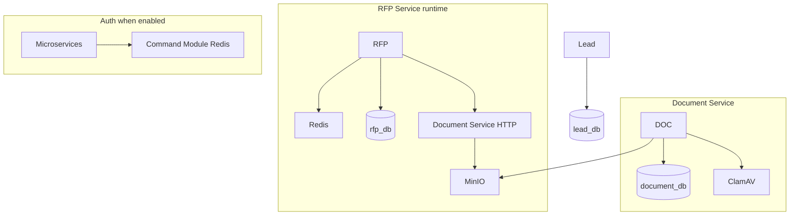

# Infrastructure and Deployment Architecture

## Ports (from `main.ts` defaults / docs)

| Component | Port |
|-----------|------|
| API Gateway | 3000 |
| auth-service (inactive) | 3001 |
| Lead | 3002 |
| Opportunity | 3003 |
| RFP | 3004 |
| Document | 3005 |
| Approval | 3006 |
| Assignment | 3007 |
| Compliance | 3008 |
| Delivery | 3009 |
| Notification | 3010 |
| Reporting | 3011 |
| Frontend Vite | 5173 |
| Command Module gateway (external ref) | 8080 |
| IAM API (host dev ref) | 3012 suggested |

## Docker Compose (repo root)

| Service | Image | Purpose |
|---------|-------|---------|
| mysql | mysql:8 | Local DB init (`document_db`, `lead_db`, …) |
| rabbitmq | 3-management | **Not used in app code** (verified grep) |
| redis | 7-alpine | RFP workers + potential session auth |
| minio | minio | Object storage |

## Document dev stack (`backend/docker-compose.local.yml`)

| Service | Host port | Purpose |
|---------|-----------|---------|
| localstack | 9000→4566 | S3 API for documents |
| clamav | 3310 | Virus scan |

**NOT VERIFIED:** production deploy manifests (Kubernetes, etc.)—not in repo.

## Service dependencies

## Deployment gaps

| Item | Status |
|------|--------|
| Nest apps in Docker | **MISSING** (compose is infra-only) |
| Single compose for full stack | **MISSING** (split root vs backend local) |
| Health checks wired to orchestrator | Partial (DB containers only) |
| Secrets management | `.env` files locally; Vault mentioned in auth_gateway only |

## Local startup (documented elsewhere)

Requires multiple terminals: infra → IAM → gateway → N× services → frontend. **End-to-end not turnkey.**