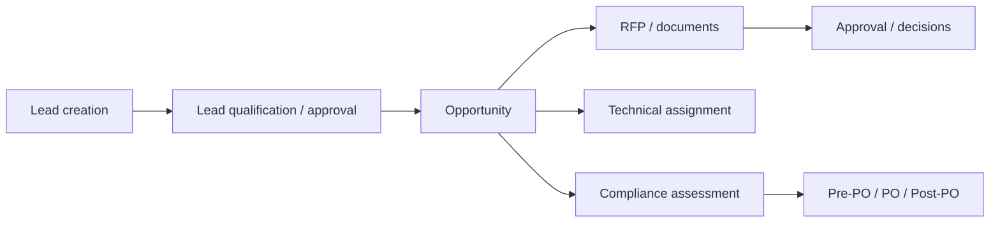

# End-to-End Business Workflow

Stages from product PRDs compared with **repository evidence** (not live E2E tests).

## End-to-end workflow diagram

## Stage implementation matrix

| Stage | Frontend | Backend API | Persistence | Cross-service | Overall |
|-------|----------|-------------|-------------|---------------|---------|
| Lead creation | Store (`Leads.jsx`) | Lead CRUD + lifecycle | `lead_db` | Approval/Opp **log stubs** | **PARTIAL** |
| Lead approval UX | Store badges | Lead lifecycle + Approval API | `lead_db` / memory | Not HTTP-connected | **PARTIAL** |
| Opportunity | Store (`Pipeline`, `Opportunity`) | Full Opportunity API | `opportunity_db` | Lead convert stub | **PARTIAL** |
| RFP / synopsis | Store + `rfpMock` | RFP + Document APIs | `rfp_db`, `document_db` | RFP→Document HTTP | **PARTIAL** |
| Document upload | Not wired | Document uploads + scan | `document_db` + MinIO | — | **API only** |
| Assignment / presales | Store teams | Assignment API | `assignment_db` | Mock clients | **PARTIAL** |
| Approval / P&L decisions | `Decisions.jsx` | Approval Scope 1 API | In-memory | — | **PARTIAL** |
| Compliance matrix | `Compliance.jsx` seed | Compliance API | `compliance_db` | Gateway path gap | **PARTIAL** |
| Pre-PO | `PrePO.jsx` Store | Catalogue only | — | — | **MOCK** |
| Post-PO | `PostPO.jsx` static | No service | — | — | **MISSING** |

## Lead lifecycle (backend detail)

`LeadLifecycleService` calls:

- `ApprovalIntegration.createApprovalRequest` — **logs** “integration pending”
- `OpportunityIntegration.convertLead` — **logs** “integration pending”

So the **workflow shape exists** in Lead Service but **does not invoke** Approval or Opportunity HTTP APIs.

## RFP path (backend-capable)

1. Create RFP (`POST /api/v1/rfps`).
2. Link/upload document (Document Service + associations).
3. Queue PDF processing (Redis/BullMQ).
4. Extraction, review, amendment compare.

Frontend **does not call** these; `RfpExtract.jsx` simulates steps via `data/rfpMock.js`.

## Opportunity path (backend-capable)

Includes stage transitions, products, commercials, contributors, PO receipt, pipeline summary — **not consumed by UI**.

## Critical path to unified product (analysis only)

1. Wire Leads UI → Lead API via gateway + CSRF.
2. Connect Lead lifecycle stubs → Approval + Opportunity HTTP.
3. Wire Pipeline/Opportunity pages → Opportunity API.
4. Replace RFP mock with Document upload + RFP API.
5. Fix gateway routes for Compliance (or add service prefix).
6. Wire Decisions → Approval API; Compliance page → Compliance API.
7. Define Pre/Post-PO scope (Opportunity extension vs Delivery service).