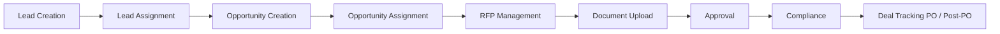

# End-to-End Business Workflow

Stages from product PRDs vs **what code actually does today**.

## Workflow map

| Stage | Frontend | API / Service | Database | Status |
|-------|----------|---------------|----------|--------|
| **Lead creation** | Leads, LeadDetail (Store) | Lead Service CRUD | `lead_db` | **UI mock** / API **implemented** |
| **Lead assignment** | Teams picker, Store fields | Assignment Service | `assignment_db` | **MISSING** (stub) |
| **Opportunity creation** | NewOpportunity, Pipeline | Opportunity Service | `opportunity_db` | **UI mock** / API **missing** |
| **Opportunity assignment** | Opportunity page owners | Assignment Service | — | **MISSING** |
| **RFP management** | RfpSynopsis, RfpExtract mock | RFP + Document | `rfp_db`, `document_db` | **Partial** (API rich; UI mock) |
| **Document upload** | Indirect via RFP UX | Document uploads | `document_db` | **API yes** / **UI no** |
| **Approval** | Decisions, lead approve | Approval + Lead lifecycle | `approval_db` | **Stub**; Lead logs only |
| **Compliance verification** | Compliance matrix | Compliance Service | `compliance_db` | **UI mock** / API **missing** |
| **Deal tracking (Pre-PO / Post-PO)** | PrePO, PostPO | Delivery / catalogue APIs | delivery_db (planned) | **MISSING** |

## Lead Service lifecycle (backend)

Implemented transitions include paths to **approve** and integrate hooks calling:

- `ApprovalIntegration.createApprovalRequest` — **logs only**
- `OpportunityIntegration.convertLead` — **logs only**

So backend anticipates workflow but **does not complete** cross-service steps.

## RFP path (backend-capable)

1. Create RFP record (`rfps`).
2. Associate document (`rfp_document_associations` + Document Service).
3. Queue PDF processing (BullMQ).
4. Extraction + human review entities.

Frontend **does not call** these steps; `RfpExtract.jsx` uses timed mock from `rfpMock.js`.

## Critical path to “real” workflow

1. Wire Leads UI → Lead API.
2. Stand up Opportunity + Assignment services (minimum viable).
3. Replace RfpExtract mock with Document upload + RFP API.
4. Approval service + connect Lead lifecycle stub.
5. Compliance service + Compliance page API.
6. Pre/Post-PO services or collapse into Opportunity until Delivery exists.