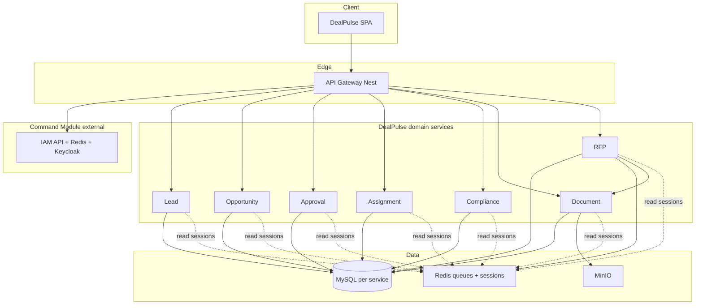

# Target System Architecture

**Existing** pieces to reuse. **Proposed** additions marked.

## High-level target

## As-built vs target

| Area | As-built | Target |
|------|----------|--------|
| Auth | Command Module client; passthrough guards | Redis session enforced; IAM permissions per route |
| Frontend data | localStorage seed | REST via gateway + optimistic UI |
| Gateway | HTTP proxy | + optional session check, rate limits |
| Opportunity→Compliance | Stubs | CRUD + workflow modules + DB migrations |
| Events | None | **Proposed:** RabbitMQ domain events (optional P2) |
| Vertical RBAC | `VERTICALS.js` | Map `me.permissions` from IAM registration |

## Frontend target pattern

1. Replace Store mutations with `*Service` calls where APIs exist.
2. Keep local state for optimistic updates / draft forms.
3. Use `me.permissions` + `RequirePermission` keys (once registered).
4. Retain vertical UX as **filter/views** on shared data—not separate auth.

## Backend target pattern

1. Implement stub services in order: **Opportunity → Approval → Assignment → Compliance** (minimal CRUD + status).
2. Replace Lead integration classes with HTTP clients + circuit breaker.
3. Enable `DealplusAuthModule` with shared `REDIS_SERVICE_URL` in all envs.
4. Add `CurrentUser` to Lead writes instead of `x-changed-by`.
5. Keep **no** in-repo auth-service; register DealPlus in IAM.

## Document database

**Target (achieved in config/docs):** single `document_db`. Blob store always MinIO/S3; metadata never duplicated across DB names.

## Deployment target (proposed)

- `docker compose --profile app` with gateway + lead + document + rfp + frontend nginx.
- Command Module started separately or via documented stack URL.
- Managed MySQL with per-service users (least privilege).