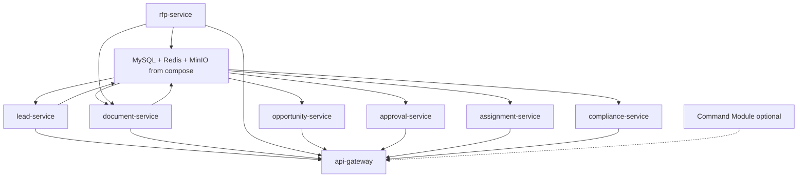
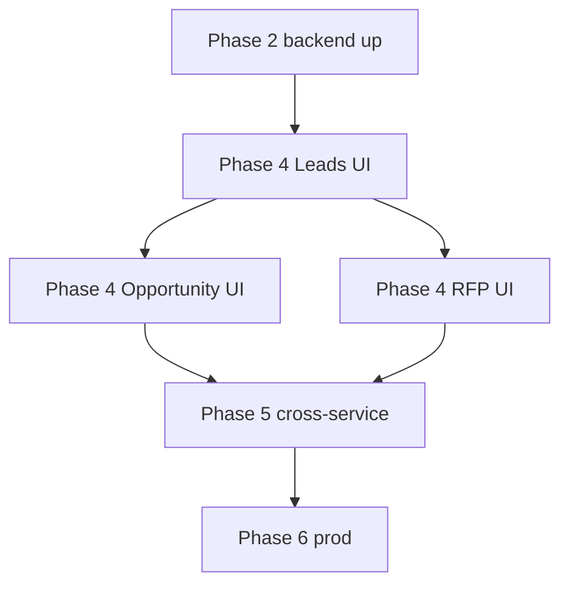

# Implementation Roadmap

Aligns with your delivery phases. **Phase 1 (discovery)** is this documentation pass — **no runtime work** included here.

## Phase alignment

| Your phase | Name | Roadmap focus |
|------------|------|----------------|
| **1** | System design & discovery | `docs/system-design/*` (current) |
| **2** | Run & verify backend independently | Per-service `.env`, migrations, health, Swagger |
| **3** | Run & verify frontend independently | Vite + auth; optional `VITE_DEMO_MODE` |
| **4** | Integrate UI ↔ API via gateway | Wire pages to `services/*`; fix gateway gaps |
| **5** | End-to-end business workflow | Cross-service HTTP; replace mocks |
| **6** | Production readiness | Docker, IAM permissions, events, observability |

## Phase 2 — Backend verification (suggested order)

| Step | Action | Success criteria |
|------|--------|------------------|
| 2.1 | Copy `apps/*/.env.example` → `.env` | Each service boots without missing `DB_*` |
| 2.2 | Run MySQL init + migrations per service | `migration:*` / `opp:migrate` / `asg:migrate` |
| 2.3 | Start Document + MinIO (+ ClamAV for uploads) | Upload + GET document |
| 2.4 | Start RFP + Redis | Health ready; optional PDF job |
| 2.5 | Smoke Opportunity, Assignment, Compliance, Approval | Swagger or curl 2xx on sample CRUD |
| 2.6 | Start gateway with all `*_SERVICE_URL` | Proxy returns upstream, not 502 |

## Phase 3 — Frontend verification

| Step | Action |
|------|--------|
| 3.1 | `frontend/.env` with `VITE_API_BASE_URL`, `VITE_AUTH_BASE_URL` → gateway |
| 3.2 | Confirm login when IAM running |
| 3.3 | Document which screens still need Store (all today) |

## Phase 4 — Integration priorities

| Order | Work item |
|-------|-----------|
| 1 | Leads + LeadDetail → `leadService` |
| 2 | Fix gateway **Compliance** path (add routes or service prefix) |
| 3 | Pipeline + Opportunity → `opportunityService` |
| 4 | RfpSynopsis + RfpExtract → `documentService` + `rfpService` |
| 5 | Decisions → `approvalService` |
| 6 | Compliance page → `complianceService` |
| 7 | Enable `REDIS_SERVICE_URL` + map IAM user to audit headers |

## Phase 5 — E2E workflow

| Item | Detail |
|------|--------|
| Replace Lead integration stubs | HTTP to Approval + Opportunity |
| Assignment real clients | Set `AUTH_SERVICE_URL`, notification URLs |
| Approval TypeORM repository | Replace in-memory for durability |
| Event bus (optional) | RabbitMQ publishers per `DEPENDENCY_HANDLING.md` |

## Phase 6 — Production readiness

- Container images per Nest app
- Secrets management (no committed `.env`)
- Permission matrix in Command Module
- Gateway rate limits, request IDs
- Deprecate or gate demo `Store` (`VITE_DEMO_MODE`)

## Dependency graph (integration sequencing)

