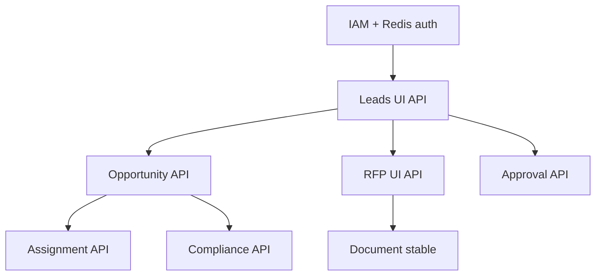

# Implementation Roadmap

Practical phases reusing existing code. Durations are indicative.

## Phase 0 — Foundations (1–2 weeks)

| Task | Delivers |
|------|----------|
| IAM: register `dealplus` app + permissions | Real RBAC |
| Enable `REDIS_SERVICE_URL` on all active services | Session enforcement |
| Document local/QA startup script | Repeatable dev |
| Fix MinIO parity for document downloads | Blob + metadata aligned |

## Phase 1 — First vertical slice (2–3 weeks)

| Task | Delivers |
|------|----------|
| Wire **Leads** pages to `leadService` | First real UI↔API path |
| Map IAM user to `x-changed-by` / `CurrentUser` | Audit correctness |
| Gateway smoke tests in CI | Regression net |

## Phase 2 — RFP + documents (2–3 weeks)

| Task | Delivers |
|------|----------|
| Replace `rfpMock` with upload → RFP create → process poll | Real RFP UX |
| RFP synopsis read from API | Store deprecation starts |
| Integration test in CI | Confidence |

## Phase 3 — Pipeline services (4–6 weeks)

| Order | Service | Minimum scope |
|-------|---------|---------------|
| 1 | Opportunity | CRUD, stages, link to `lead_id` |
| 2 | Approval | Pending list, approve/reject; Lead lifecycle HTTP |
| 3 | Assignment | Assign users to opportunity |
| 4 | Compliance | Matrix lines per opportunity |

Wire **Pipeline, Opportunity, Decisions, Compliance** pages incrementally.

## Phase 4 — Pre/Post-PO (future)

Delivery service or extend Opportunity with PO milestones per PRD scope decision.

## Phase 5 — Hardening

- RabbitMQ events (lead.created, opportunity.won).
- Observability (request IDs, structured logs).
- Docker images per service.
- Remove or gate demo Store/seed behind `VITE_DEMO_MODE`.

## Dependency graph

