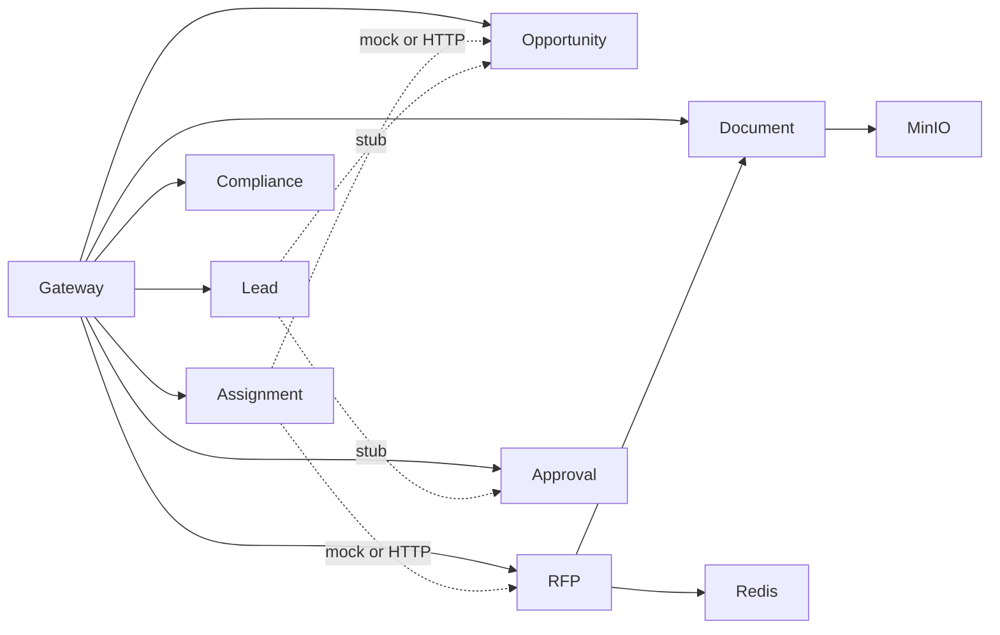

# Executive Summary — Phase 1 Discovery

**Analysis date:** 2026-11-25 · **Method:** Read-only repository inspection (no `npm install`, no service starts, no migrations run, no live DB).

---

## What have we built?

| Layer | Deliverable |
|-------|-------------|
| **Frontend** | Full React/Vite **demo** of the sales workflow (leads through post-PO), hash routing, Command Module login |
| **Backend** | **Seven** domain microservices with real APIs (Lead, Document, RFP, Opportunity, Assignment, Compliance) plus **partial** Approval (Scope 1) |
| **Gateway** | Nest proxy to IAM and business services |
| **Data** | Per-service MySQL schemas (migrations in repo); RFP async workers on Redis |
| **Infra templates** | Root `docker-compose.yml` (MySQL, Redis, RabbitMQ, MinIO); `backend/docker-compose.local.yml` (LocalStack, ClamAV) |
| **Auth integration** | Command Module client (frontend + `libs/command-module-auth`); optional session guard on services |

---

## What is implemented vs incomplete?

| Area | Verdict |
|------|---------|
| **Implemented (backend)** | Lead, Document, RFP, Opportunity, Assignment, Compliance APIs + migrations |
| **Partial** | API Gateway (proxy only); Approval (in-memory); auth guards (optional); Lead cross-service hooks |
| **Mock / placeholder** | Frontend business data (`Store` + seed); Assignment upstream clients; Approval actors/tokens; in-repo auth/delivery/notification/reporting |
| **Missing** | UI wired to business APIs; RabbitMQ usage; Pre/Post-PO backend; IAM DealPlus permission catalog |
| **Not verified** | Full stack boot, blob download, PDF OCR on a given host, production deploy |

---

## How does the frontend work?

- **Routing:** Custom hash router in `App.jsx` (10 authenticated routes + Login).
- **Auth:** `authService` → gateway → Command Module (`/api/auth/login`, `/api/me`); vertical picker uses **`VERTICALS` mock** for permissions.
- **Data:** Almost all screens read/write **`Store.jsx`** persisted in **`localStorage`** — not REST.
- **API layer:** `frontend/src/services/*.js` + `apiClient.js` (CSRF-ready) — **prepared but unused** by pages.

---

## How does the backend work?

- **Monorepo:** `nest-cli.json` registers 12 apps; each listens on its own port with `/api/v1` prefix (except IAM proxy paths on gateway).
- **Gateway:** Forwards path prefixes to configured upstream URLs; validates critical env on boot.
- **Services:** Nest modules per domain; TypeORM to dedicated database; RFP adds BullMQ workers.
- **S2S:** RFP → Document HTTP client; Assignment → optional HTTP to Opportunity/RFP/Notification (falls back to mock).

---

## Service dependencies

---

## Database consistency

| Question | Answer |
|----------|--------|
| One DB per service? | **Yes** — defined in `init-databases.sql` and service configs |
| `document_db` consolidated? | **Yes** per consolidation doc; verify local `.env` values |
| Approval | Migrations exist; **runtime not using DB** (in-memory) |
| Cross-DB FKs? | **None** (by design) |

---

## Command Module authentication

| Question | Answer |
|----------|--------|
| Integrated? | **Partially** — login/session on frontend; gateway proxies IAM |
| Enforced on microservices? | **Only if** `REDIS_SERVICE_URL` set → `SessionAuthGuard`; else **open** |
| UI authorization? | **Mock verticals**, not IAM permissions |

---

## What is required to run?

### Backend (independently — Phase 2)

| Requirement | Services affected |
|-------------|-------------------|
| MySQL + per-DB migrations | All domain services |
| `apps/<service>/.env` with `DB_*` | Each Nest app |
| Redis | RFP workers |
| MinIO or LocalStack + ClamAV | Document uploads |
| Poppler/Tesseract (optional) | RFP PDF/OCR |
| Command Module (optional) | Gateway IAM proxy + session guards |
| Many terminals or process manager | One Nest app per port |

### Frontend (independently — Phase 3)

| Requirement | Notes |
|-------------|-------|
| `npm run dev` (Vite) | Works **without** backend using Store |
| `VITE_*` → gateway | For real login |
| Command Module running | For auth (else login fails gracefully) |

### Full integration (Phase 4)

| Requirement | Notes |
|-------------|-------|
| API Gateway with all `*_SERVICE_URL` | Upstreams must match ports in `.env` |
| Fix Compliance gateway paths | Or call Compliance directly during dev |
| Wire pages to services | Replace Store mutations incrementally |
| CSRF + cookies on `apiFetch` | Already in `apiClient.js` |

---

## Critical blockers

1. **UI disconnected** from implemented backends (except auth).
2. **Gateway Compliance route mismatch** — service APIs not under `/api/v1/compliance`.
3. **Session guards optional** — security gap without Redis + IAM ops.
4. **Lead workflow incomplete** — Approval/Opportunity not called over HTTP.
5. **Approval data ephemeral** — in-memory repository.
6. **No unified runbook** — operational friction for team onboarding.

---

## Top next steps (Phase 2–4)

| # | Task |
|---|------|
| 1 | Document and script multi-service local startup |
| 2 | Wire **Leads** to Lead API |
| 3 | Extend gateway for Compliance paths |
| 4 | Enable `REDIS_SERVICE_URL` + IAM permissions |
| 5 | Wire **Pipeline/Opportunity** to Opportunity API |
| 6 | Replace **RfpExtract** mock with Document + RFP APIs |

See [Implementation roadmap](./13-implementation-roadmap.md) for phase detail.